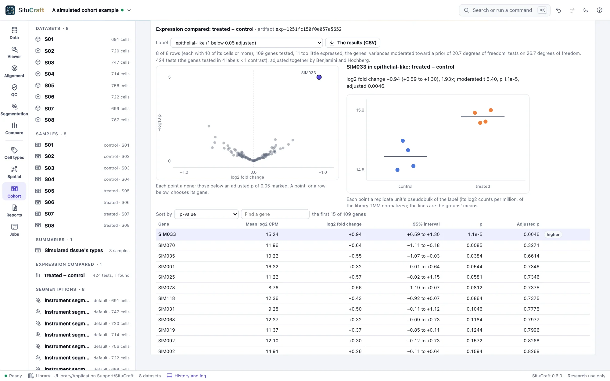
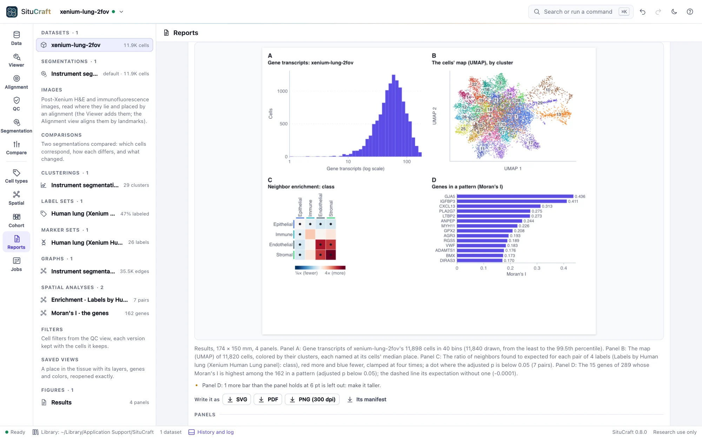

# SituCraft

<picture>
  <source media="(prefers-color-scheme: dark)" srcset="docs/images/viewer-genes-dark.webp">
  
</picture>

SituCraft is an open-source, local-first workbench for imaging-based spatial transcriptomics,
starting with 10x Genomics Xenium output bundles. It takes a section from the instrument's bundle to
results others can check: the tissue seen at any zoom, cells segmented and typed, the pathology
brought in, the tissue's organization measured, samples compared, and figures, methods and
certificates written, each step kept on record.

It is one self-contained program for macOS, Linux and Windows. It opens as a desktop window, needs
no Python, R or account, and keeps your data on your computer.

**Current release:** 0.8.0 ([changelog](CHANGELOG.md), [roadmap](situcraft-spec/roadmap.md)).

## Features

- **Open and check a bundle.** Every file read with SituCraft's own readers, validated, and 22 of
  the run's recorded values recomputed from its data.
- **See the tissue.** Morphology stains, transcripts of chosen genes and cell outlines at any
  zoom; a QC view that explains the run's metrics, maps quality over the tissue and keeps cell
  filters as versions.
- **Segment cells.** SituCraft's own transcript-informed segmentation, or other tools' imported
  (SpatialData, Baysor, GeoJSON, Xenium Ranger); any two compared cell by cell, their differences
  ranked for review, and the choice recorded with its reason.
- **Type cells.** Clusters and a map linked to the tissue; labels from marker genes or a
  single-cell reference, each with its confidence and evidence; a review queue.
- **Bring in the pathology.** Post-Xenium H&E and immunofluorescence images aligned and checked
  in µm; regions drawn and exchanged with QuPath; reviews kept with who and why.
- **Measure the tissue's organization.** Cell graphs, neighborhood enrichment, distances, regions
  compared, niches and spatially variable genes; any answer made again on another segmentation.
- **Compare samples.** A study's sections in one project with a stated design, and cell types'
  abundance, expression and spatial statistics compared between groups with the subject, not the
  cell, as the unit.
- **Write results others can check.** Figures with scale bars and legends drawn from the project;
  a methods section written from the record of every step; certificates that `situcraft verify`
  makes again from the bundles; reports and packages that open in any browser and check
  themselves.
- **Reproducible and open.** Every result is an artifact with its lineage, the same bits on every
  computer; exports to SpatialData, AnnData, Parquet, CSV and GeoJSON; scripts drive the window by
  remote control.
- **Work with AI agents.** An agent such as Claude Code asks SituCraft about your projects and
  results through `situcraft mcp`, a Model Context Protocol server, in a window you watch:
  read-only unless you allow it to change the project, run jobs or touch files. An
  [agent benchmark](benchmark/) grades agents on tasks whose answers are known.

Every method is checked against an independent implementation or a known truth (scanpy, Squidpy,
SingleR, limma, edgeR, QuPath and simulated tissues among them): see
[methods and validation](https://robert-mcdermott.github.io/situcraft/science.html).

## A look around

<picture>
  <source media="(prefers-color-scheme: dark)" srcset="docs/images/qc-dark.webp">
  
</picture>

The QC view: every metric the run recorded, explained, with SituCraft's own value beside it where
it can be recomputed from the data; quality mapped over the tissue; plots linked to the tissue.

<picture>
  <source media="(prefers-color-scheme: dark)" srcset="docs/images/viewer-methods-dark.webp">
  
</picture>

The Breast example's cells, colored by how the instrument found each one.

<picture>
  <source media="(prefers-color-scheme: dark)" srcset="docs/images/workspace-dark.webp">
  
</picture>

The comparison workspace: two segmentations on the tissue with one camera, their differences
ranked for review, and the decision recorded with its reason.

<picture>
  <source media="(prefers-color-scheme: dark)" srcset="docs/images/cellmap-dark.webp">
  
</picture>

The Cell types view: the cells' map beside the tissue, linked, colored by cluster, gene or label.

<picture>
  <source media="(prefers-color-scheme: dark)" srcset="docs/images/expression-dark.webp">
  
</picture>

The Cohort view: a simulated cohort's subjects compared by condition, each subject one observation;
SIM033, raised in the treated subjects' epithelial-like cells, the only gene found.

<picture>
  <source media="(prefers-color-scheme: dark)" srcset="docs/images/figure-results-dark.webp">
  
</picture>

The Reports view: a figure of results drawn from the project, previewed as it will print, each file
written carrying what it was drawn from.

More screenshots, a page for every view, are in the
[user guide](https://robert-mcdermott.github.io/situcraft/docs/).

## Install

One file per platform, installed by a one-line installer that checks its checksum
([docs/INSTALLING.md](docs/INSTALLING.md)). On macOS and Linux:

```sh
curl --proto '=https' --tlsv1.2 -fsSL https://raw.githubusercontent.com/robert-mcdermott/situcraft/main/install.sh | sh
```

On Windows, in PowerShell:

```powershell
irm https://raw.githubusercontent.com/robert-mcdermott/situcraft/main/install.ps1 | iex
```

Or build from source with Go (the version in `go.mod` or newer): `go build -o situcraft .`

16 GB of memory is recommended for whole sections; 8 GB is enough for the examples
([what it needs](docs/INSTALLING.md#what-it-needs)).

## Getting started

```sh
situcraft                                # then try an example from the start page
situcraft /path/to/Xenium_output_bundle  # or open your own
```

SituCraft opens in a desktop window: a Chromium-family browser (Chrome, Edge, Brave or Chromium)
in app mode with its own profile, or else your default browser. Name bundles (their folder, their
`.zip` or their `experiment.xenium`) or folders of them on the command line, or use **Open a
bundle** in the window. A bundle is read where it is: SituCraft never copies, changes or moves it.
Running `situcraft <paths>` again hands them to the SituCraft already running.

The start page offers two public Xenium sections, a simulated tissue whose every cell is known and
simulated cohorts, each with a guided tour and worked examples: questions answered step by step,
saying first what to expect. The [user guide](https://robert-mcdermott.github.io/situcraft/docs/)
walks through the examples and every view.

<details>
<summary>Options</summary>

| Flag | Default | What it does |
| --- | --- | --- |
| `--port` | 8840 | Preferred port; the next free one up to 8859 is used if it is taken |
| `--window` | `app` | `app` (a desktop window), `browser` (the default browser) or `none` |
| `--keep-running` | off | Keep serving after the window is closed |
| `--data-dir` | `<user config dir>/SituCraft` | Where the project library is kept |
| `--cache-dir` | `<user cache dir>/situcraft` | Where derived data go (image tiles, transcript indexes, tiled outlines, a zipped bundle's unpacked members); can be deleted at any time |
| `--cache-limit` | `10GB` | The size the cache is kept within, removing what was used least recently (`500MB`, `20GB`; `0` for no limit) |
| `--examples-dir` | `<data dir>/examples` | Where example datasets are downloaded, when you ask |
| `--remote-control` | off | Let programs on this computer drive the window ([remote control](docs/REMOTE-CONTROL.md)) |
| `--host` | 127.0.0.1 | Interface to bind |
| `--dev` | off | Serve `web/` from the working directory (development) |
| `--version` | | Print `situcraft X.Y.Z` and exit |

</details>

## Python and R

The `situcraft` packages for Python and R drive a running SituCraft from a script or a notebook:
each action is a function, tables come back as data frames and pictures as files
([clients](clients/README.md)).

## Command-line tools

- `situcraft mcp` is a Model Context Protocol server for AI agents: read-only tools by default,
  `--allow edits,compute,files` for more ([AI agents](docs/MCP.md)).
- `situcraft verify --data <folder of bundles> <certificate, report or package>` makes a
  certificate's results again from the bundles and compares every file bit for bit
  ([the record](https://robert-mcdermott.github.io/situcraft/docs/record.html#verify)).
- `situcraft run --recipe <recipe> --bundle <bundle> --out <new folder>` makes a result's recipe,
  saved from the app, without the window: its artifacts, `run.json`, a certificate and with
  `--report` its report; on a batch of bundles, one a cluster's array task
  ([running at scale](https://robert-mcdermott.github.io/situcraft/docs/running.html)).
- `situcraft refine <bundle> <new folder>` runs SituCraft's transcript-informed segmentation
  without the window, from a preset or a recipe saved in the app
  ([Formats](docs/FORMATS.md#refinements-in-the-terminal-situcraft-refine)).
- `situcraft simulate <new folder>` makes a tissue (or, with `--cohort`, a cohort of sections)
  whose every cell, transcript and effect is known, as a Xenium bundle with its truth
  ([Formats](docs/FORMATS.md#simulated-tissues-situcraft-simulate)).

Each takes `-h` for its settings.

## Documentation

- [The website](https://robert-mcdermott.github.io/situcraft/): the user guide, installing, and
  the methods with their validation ([docs/site/](docs/site/README.md) builds it).
- [Formats](docs/FORMATS.md): what SituCraft reads and writes.
- [AI agents (MCP)](docs/MCP.md): setting up Claude Code, Claude Desktop and other clients, and what
  an agent may do.
- [Remote control](docs/REMOTE-CONTROL.md): driving the window from scripts and notebooks.
- [Installing](docs/INSTALLING.md): release files, installers, upgrading, uninstalling.
- [Requirements](situcraft-spec/requirements.md): what SituCraft must do.
- [Design](situcraft-spec/design.md): how it is built and why.
- [Roadmap](situcraft-spec/roadmap.md): the order of the work, wave by wave (wave *N* is release
  0.*N*.0).
- [Research](situcraft-spec/research.md): the methods, formats and datasets behind it, with
  citations.
- [Conventions](situcraft-spec/conventions.md): code, science and terminology rules.

## Development

```sh
go test -race -timeout 30m ./...         # the Go host (the sampler's tests take minutes)
node --test "web/lib/**/*.test.mjs"      # the browser modules
node validation/run.mjs                  # checks against references (validation/README.md)
node validation/run.mjs viewer           # the tissue viewer in headless Chrome against its data
node docs/capture/capture.mjs --audit    # the screenshots, through remote control, checked by axe-core
go run . --dev --window none             # serve web/ from disk at http://127.0.0.1:8840
```

The web app is plain ES modules with no build step and no dependencies. CI tests each commit
once. A release is a tag (`v0.2.0`) whose files CI has passed on; the release workflow builds the
six binaries and drafts the release.

## Example data

The example datasets are 10x Genomics' Xenium human Lung and Breast 2-FOV output bundles, used under
[CC BY 4.0](https://creativecommons.org/licenses/by/4.0/) from
[10x Genomics' example data](https://www.10xgenomics.com/support/software/xenium-onboard-analysis/latest/resources/xenium-example-data).
SituCraft downloads them from 10x Genomics only when asked; they are not part of SituCraft or this
repository. The screenshots in this documentation show these data. The other examples, a simulated
tissue and three simulated cohorts, are made by SituCraft on your computer when asked.

## Research use

SituCraft is for research use only. It is not a medical device and makes no diagnostic claims.

## License

[Apache License 2.0](LICENSE). See [NOTICE](NOTICE).
