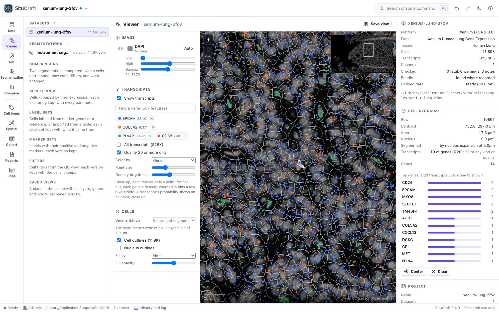
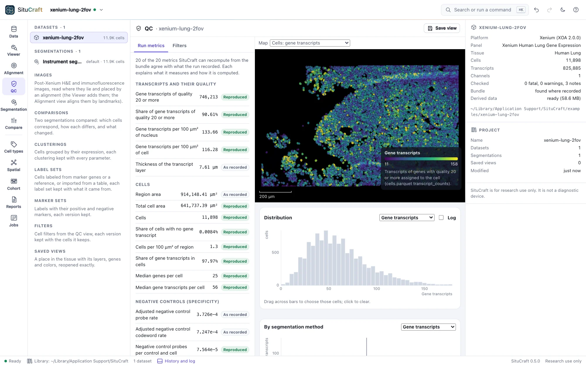
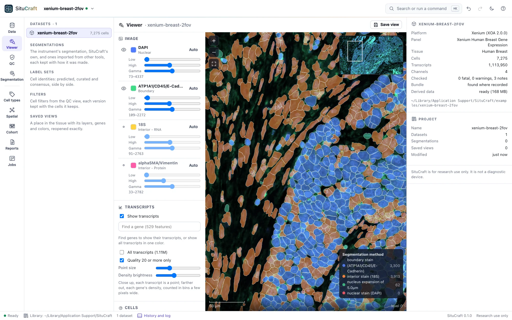
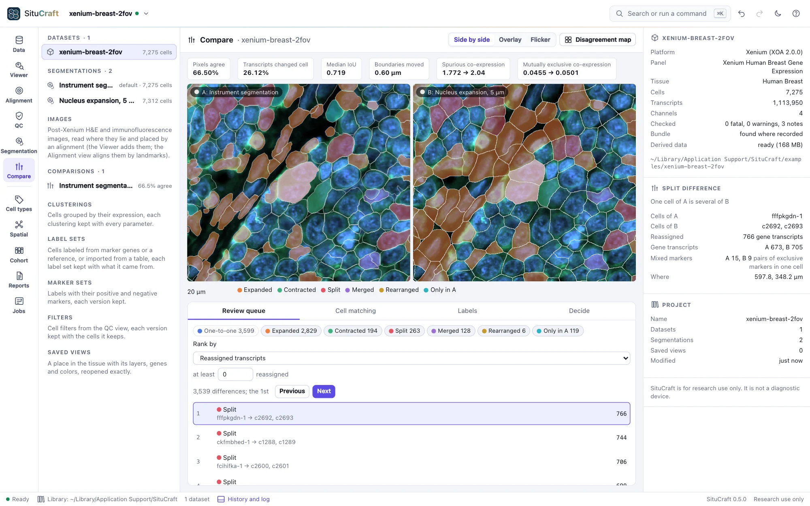
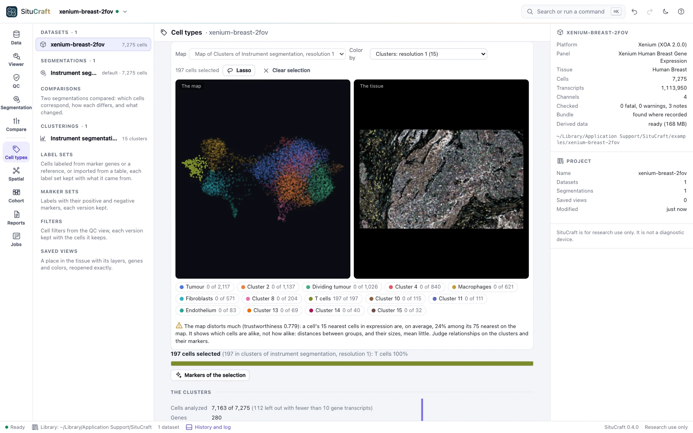

# SituCraft

<picture>
  <source media="(prefers-color-scheme: dark)" srcset="docs/images/viewer-genes-dark.webp">
  
</picture>

SituCraft is an open-source, local-first workbench for imaging-based spatial transcriptomics,
starting with 10x Genomics Xenium output bundles. It makes cell segmentation, pathology review and
tissue-level spatial analysis one reproducible workflow:

- open and validate a bundle;
- see the tissue, its transcripts and its cells at any zoom;
- segment cells with built-in transcript-informed segmentation, and compare segmentations and
  choose one with evidence;
- register H&E;
- type cells, find niches and compare samples;
- export open formats with complete provenance.

SituCraft runs as one self-contained program on macOS, Linux and Windows. It opens as a desktop
window, needs no other software, and keeps your data on your computer. 16 GB of memory is
recommended for whole sections; 8 GB is enough for the examples ([what it needs](docs/INSTALLING.md#what-it-needs)).

**Status:** 0.6.0. SituCraft opens a Xenium output bundle (folder or zip), reads every byte of it
with its own readers, validates it (fatal problems, warnings and notes, and 22 of the run's
recorded values recomputed from its data) and records it in a project. Its tissue viewer shows the
morphology stains, the transcripts of chosen genes and the cells at any zoom, every image sample
exactly as recorded; its QC view explains the run's metrics, maps quality over the tissue and keeps
cell filters as reproducible versions. Segmentations are artifacts with their lineage: the
instrument's, SituCraft's own, and other tools' imported from SpatialData, Baysor, GeoJSON or
Xenium Ranger. Any two are compared cell by cell, with measures of transcripts given to the wrong
cell; a workspace shows both on the tissue, ranks their differences for review, and records the
decision that promotes one, with its reason. Any segmentation exports to SpatialData, AnnData,
Parquet, CSV, Matrix Market and GeoJSON, or is prepared for Xenium Ranger, every file listed by its
SHA-256. Programs drive the window by remote control.

Since 0.3.0, SituCraft segments cells from their transcripts itself (after Jones et al. 2025),
redrawing the instrument's cells where their transcripts lie, in the app's segmentation studio or
with `situcraft refine`. The same settings and seed give the same segmentation, byte for byte, on
any computer. Each transcript's probability of its cell, each cell's boundary certainty and the
cells it is least sure of are kept, and drawn on the tissue. Large tissues are refined in patches.
It is validated against simulated tissues whose every cell is known, which `situcraft simulate`
makes, and against an independent reference: on the standard simulated tissue it puts 84.7% of
transcripts in their true cell, against 82.2% for the instrument's nucleus expansion and 75.2% for
the reference. Three example datasets (two public Xenium bundles, downloaded in a click, and a
simulated tissue with its truth) come with guided tours and worked examples. See the
[roadmap](situcraft-spec/roadmap.md) and the [changelog](CHANGELOG.md).

Since 0.4.0, SituCraft gives cells identities with their evidence, in the Cell types view. A
segmentation's cells are clustered by their expression, each cluster with its markers, and laid
out on a map (UMAP) linked to the tissue: cells selected on either are selected on both. They are
labeled from marker genes (a hierarchy of cell types, each with positive and negative markers;
starter sets for the example panels from published cell atlases, edited as versions), from a
labeled single-cell reference (each cell correlated with each label's profile, then fine-tuned on
the leading labels' genes), or imported from CSV, Parquet, AnnData or Xenium Explorer's cell
groups. Each label has its confidence and its evidence; curated and consensus versions sit side by
side, and a review queue lists the cells most likely mislabeled. A clustering and its labels are
made again on another segmentation in one step and read through the two segmentations'
comparison: what the choice of segmentation changes in the cells' identities. Whole sections of
hundreds of thousands of cells, and Xenium Prime's 5,000-gene panel, are clustered and mapped in
minutes, the same for a seed on any computer. The steps and defaults are scanpy's and SingleR's,
and the results are validated against scanpy, leidenalg, umap-learn, scikit-learn and SingleR, and
against the simulated tissue's true types: labeled from its types' markers, 98.3% of the
instrument's cells take their true type, and 99.9% of SituCraft's refined cells. Worked examples
cluster and label the Lung cells, read the simulated tissue's labels against its truth, and the
Breast cells' labels under two segmentations.

Since 0.5.0, SituCraft bridges to pathology. Post-Xenium H&E and immunofluorescence images of the
section are drawn on the tissue, read where they lie (pyramidal OME-TIFFs, as Xenium Explorer
requires, from bundles of Xenium Onboard Analysis 1.0 on), and placed by the alignment Xenium
Explorer saves, by landmarks placed on both images side by side, or automatically by the nuclei,
with a smooth deformation for a section that stretched. Every alignment is a version with its
fit's errors in µm, and is checked over the whole section: a checkerboard, flicker, DAPI's edges,
and where it is off, measured by local matches. On the breast cancer section of Janesick et al.
(2023), the automatic alignment of its immunofluorescence image is off by 0.48 µm (median) where
10x's is off by 0.85 µm. Regions are drawn over any layer (a rectangle, a polygon, freehand or a
brush), named and classed, their cells counted and chosen, kept as versions and exchanged with
QuPath as GeoJSON in an image's own pixels, checked against QuPath itself. Cells and regions are
reviewed (accepted, relabeled, ambiguous, excluded, a segmentation concern, a comment), each review
kept with who, why, the value before and after, the label set, the label's confidence and the
alignment in use, and written as CSV or JSON. The simulated example now has an H&E and an
immunofluorescence image with their truth, and worked examples that align the H&E three ways and
score each, take regions to QuPath and back, and review the cells a queue ranks first.

Since 0.6.0, SituCraft asks how the tissue is organized, in the Spatial view: graphs of which cells
are neighbors (the Delaunay triangulation of their centers, their nearest neighbors, a radius, or
contact in the segmentation), edge for edge those SciPy and Squidpy build; which cell types are
neighbors more or less often than chance (neighborhood enrichment, its expectation exact, its
significance by permutation, within regions if asked) and at what distances (co-occurrence),
Squidpy's numbers on the same cells; how far each type lies from the nearest of each other, and at
what scale cells gather or keep apart (Ripley's K and L in the tissue or a region, edge-corrected),
each against the labels dealt at random; each region's cells per mm² of its tissue and per labeled
cell, regions compared with intervals, and which types fill a region, stay out of it or gather at
its margin; the tissue's kinds of place (cellular neighborhoods), how stable they are, and their
genes; which genes are expressed in a spatial pattern (Moran's I, Squidpy's exactly) and where; any
answer made again on another segmentation in one step and read with the first, number by number,
with the cells behind each change; and every number's cells shown on the tissue. A million cells'
graphs, enrichment and niches take seconds on four cores, and their Moran's I under two minutes in
1 GB. Worked examples ask which cell types are neighbors in the Breast section and whether its
immune cells enter its tumor, read the simulated tissue's niches against its domains, find the Lung
genes in a pattern, and make an answer again under another segmentation.

In development for 0.7.0: samples and cohorts. A study's sections in one project, each a sample (or
its regions, such as a tissue microarray's cores), described by the subject it came from, its
condition and any field added, beside its run, slide and panel read from its bundle, and written
and read as CSV. Simulated cohorts (`situcraft simulate --cohort`, and the start page's **A
simulated cohort**) are sections of subjects in groups whose differences are known, with their
truth, for checking comparisons of groups. The design names the replicate unit, the groups and
the covariates before any comparison, as a model matrix in treatment coding, and refuses what it
cannot estimate or what a batch could explain. Every sample is then measured the same way (the
same labels, graph and questions) and summarized in the cohort table: its cells by label, niches
found across the samples together, its quality, its spatial statistics and its pseudobulk, each
number traced to the artifact it came from. Before any comparison, cohort QC lays the samples side
by side: samples far out flagged with the reason (never passed or failed), the numbers by slide,
run and panel, a group confounded with a batch said, the pseudobulk's principal components, and the
panels compared so that only genes every sample measured are compared.

## A look around

<picture>
  <source media="(prefers-color-scheme: dark)" srcset="docs/images/qc-dark.webp">
  
</picture>

The QC view: every metric the run recorded, explained, with SituCraft's own value beside it where
it can be recomputed from the data; quality mapped over the tissue; plots linked to the tissue.

<picture>
  <source media="(prefers-color-scheme: dark)" srcset="docs/images/viewer-methods-dark.webp">
  
</picture>

The Breast example's cells, colored by how the instrument found each one.

<picture>
  <source media="(prefers-color-scheme: dark)" srcset="docs/images/workspace-dark.webp">
  
</picture>

The comparison workspace: two segmentations on the tissue with one camera, their differences
ranked for review, and the decision recorded with its reason.

<picture>
  <source media="(prefers-color-scheme: dark)" srcset="docs/images/cellmap-dark.webp">
  
</picture>

The Cell types view: the cells' map beside the tissue, linked, colored by cluster, gene or label.

More: [checking a bundle](docs/images/data-light.webp), [the tissue's stains](docs/images/viewer-light.webp),
[transcripts outside cells](docs/images/qc-outside-light.webp), [filters as versions](docs/images/qc-filter-light.webp),
[saved views](docs/images/saved-views-light.webp), [the methods paragraph](docs/images/methods-light.webp),
[a guided tour](docs/images/tour-light.webp), [a segmentation's lineage](docs/images/segmentation-light.webp),
[nucleus expansion compared with the instrument's segmentation](docs/images/expansion-light.webp),
[a segmentation imported from SpatialData](docs/images/import-light.webp),
[two segmentations compared](docs/images/comparison-light.webp),
[the comparison workspace's disagreement map](docs/images/workspace-map-light.webp),
[a worked example finding planted errors](docs/images/worked-light.webp),
[the segmentation studio](docs/images/studio-light.webp),
[a refinement on the tissue, by its certainty](docs/images/refined-light.webp),
[exporting a segmentation](docs/images/export-light.webp),
[cells clustered by their expression](docs/images/celltypes-light.webp),
[the clusters on the tissue](docs/images/clusters-light.webp),
[cells labeled from marker genes](docs/images/labels-light.webp),
[cells labeled from a single-cell reference](docs/images/reference-light.webp),
[the labels under two segmentations](docs/images/impact-light.webp),
[the instrument's clusters imported as labels](docs/images/imported-light.webp),
[the review queue and a cell's evidence](docs/images/review-light.webp),
[a worked example reading labels against the simulated truth](docs/images/worked-labels-light.webp),
[the Jobs view](docs/images/jobs-light.webp).

## Install

One file per platform, installed by a one-line installer that checks its checksum
([docs/INSTALLING.md](docs/INSTALLING.md)). On macOS and Linux:

```sh
curl --proto '=https' --tlsv1.2 -fsSL https://raw.githubusercontent.com/robert-mcdermott/situcraft/main/install.sh | sh
```

On Windows, in PowerShell:

```powershell
irm https://raw.githubusercontent.com/robert-mcdermott/situcraft/main/install.ps1 | iex
```

Or build from source with Go (the version in `go.mod` or newer): `go build -o situcraft .`

## Getting started

```sh
situcraft                                # then try an example from the start page
situcraft /path/to/Xenium_output_bundle  # or open your own
```

SituCraft opens in a desktop window: a Chromium-family browser (Chrome, Edge, Brave or Chromium)
in app mode with its own profile, or else your default browser. Name bundles (their folder, their
`.zip` or their `experiment.xenium`) or folders of them on the command line, or use **Open a
bundle** in the window. A bundle is read where it is: SituCraft never copies, changes or moves it.
Running `situcraft <paths>` again hands them to the SituCraft already running.

The [user guide](https://robert-mcdermott.github.io/situcraft/docs/) on SituCraft's website walks
through the examples and every view, a page a subject (its sources are in
[docs/site/pages/docs/](docs/site/pages/docs/)).

## Options

| Flag | Default | What it does |
| --- | --- | --- |
| `--port` | 8840 | Preferred port; the next free one up to 8859 is used if it is taken |
| `--window` | `app` | `app` (a desktop window), `browser` (the default browser) or `none` |
| `--keep-running` | off | Keep serving after the window is closed |
| `--data-dir` | `<user config dir>/SituCraft` | Where the project library is kept |
| `--cache-dir` | `<user cache dir>/situcraft` | Where derived data go (image tiles, transcript indexes, tiled outlines, a zipped bundle's unpacked members); can be deleted at any time |
| `--cache-limit` | `10GB` | The size the cache is kept within, removing what was used least recently (`500MB`, `20GB`; `0` for no limit) |
| `--examples-dir` | `<data dir>/examples` | Where example datasets are downloaded, when you ask |
| `--remote-control` | off | Let programs on this computer drive the window ([remote control](docs/REMOTE-CONTROL.md)) |
| `--host` | 127.0.0.1 | Interface to bind |
| `--dev` | off | Serve `web/` from the working directory (development) |
| `--version` | | Print `situcraft X.Y.Z` and exit |

## Simulated tissues

`situcraft simulate <new folder>` makes a tissue whose every cell, nucleus and transcript is
known. It writes the tissue as a Xenium output bundle labeled simulated, with the truth in its
`truth/` folder, so that any segmentation can be scored against it. SituCraft and other tools
(spatialdata-io among them) read the bundle as they read Xenium's. The same seed gives the same
bundle on any computer. `--preset large` makes a tissue of 6 × 5 mm and 55 million transcripts,
a field at a time, for measuring at scale. `--reference N` also writes a single-cell reference of
the tissue's types (N cells of each, as AnnData Zarr) to label its cells from. `situcraft simulate
-h` lists the settings, and
[Formats](docs/FORMATS.md#simulated-tissues-situcraft-simulate) describes the files.

## Refinements in the terminal

`situcraft refine <bundle> <new folder>` runs SituCraft's transcript-informed segmentation of a
bundle without the app, from a preset or a recipe saved in the app (`--recipe`), and writes its
segmentation files with the recipe beside them. The same recipe gives the same segmentation, byte
for byte, in the app or the terminal; the folder imports back into the app. `situcraft refine -h`
lists the settings, `--preflight` says what a run would need, and
[Formats](docs/FORMATS.md#refinements-in-the-terminal-situcraft-refine) describes the files.

## Documentation

- [The website](https://robert-mcdermott.github.io/situcraft/): the user guide, installing, and
  the methods with their validation ([docs/site/](docs/site/README.md) builds it).
- [Formats](docs/FORMATS.md): what SituCraft reads and writes.
- [Remote control](docs/REMOTE-CONTROL.md): driving the window from scripts and notebooks.
- [Installing](docs/INSTALLING.md): release files, installers, upgrading, uninstalling.
- [Requirements](situcraft-spec/requirements.md): what SituCraft must do.
- [Design](situcraft-spec/design.md): how it is built and why.
- [Roadmap](situcraft-spec/roadmap.md): the order of the work, wave by wave (wave *N* is release
  0.*N*.0).
- [Research](situcraft-spec/research.md): the methods, formats and datasets behind it, with
  citations.
- [Conventions](situcraft-spec/conventions.md): code, science and terminology rules.

## Development

```sh
go test -race -timeout 30m ./...         # the Go host (the sampler's tests take minutes)
node --test "web/lib/**/*.test.mjs"      # the browser modules
node validation/run.mjs                  # checks against references (validation/README.md)
node validation/run.mjs viewer           # the tissue viewer in headless Chrome against its data
node docs/capture/capture.mjs --audit    # the screenshots, through remote control, checked by axe-core
go run . --dev --window none             # serve web/ from disk at http://127.0.0.1:8840
```

The web app is plain ES modules with no build step and no dependencies. CI tests each commit
once. A release is a tag (`v0.2.0`) whose files CI has passed on; the release workflow builds the
six binaries and drafts the release.

## Example data

The example datasets are 10x Genomics' Xenium human Lung and Breast 2-FOV output bundles, used under
[CC BY 4.0](https://creativecommons.org/licenses/by/4.0/) from
[10x Genomics' example data](https://www.10xgenomics.com/support/software/xenium-onboard-analysis/latest/resources/xenium-example-data).
SituCraft downloads them from 10x Genomics only when asked; they are not part of SituCraft or this
repository. The screenshots in this documentation show these data. The third example, a simulated
tissue, is made by SituCraft on your computer when asked.

## Research use

SituCraft is for research use only. It is not a medical device and makes no diagnostic claims.

## License

[Apache License 2.0](LICENSE). See [NOTICE](NOTICE).
