# Getting started with SituCraft

SituCraft opens the output of a 10x Genomics Xenium run (an *output bundle*), checks it, and shows
the tissue, its transcripts and its cells at any zoom, with quality control linked to the tissue.
Everything runs on your computer; your data are never uploaded.

This guide takes you from installing SituCraft to a saved, reproducible view of your tissue.

## 1. Install and start it

Install SituCraft with the one-line installer ([Installing](INSTALLING.md)), then run:

```sh
situcraft
```

SituCraft opens in its own window: Chrome, Edge, Brave or Chromium in app mode if you have one,
else your default browser. The terminal shows where it keeps your projects, its cache and the
example datasets. Closing the window stops SituCraft (`--keep-running` keeps it serving).

The start page offers your recent projects, the example datasets and **Open a bundle**.

## 2. Try an example

<picture>
  <source media="(prefers-color-scheme: dark)" srcset="images/start-dark.webp">
  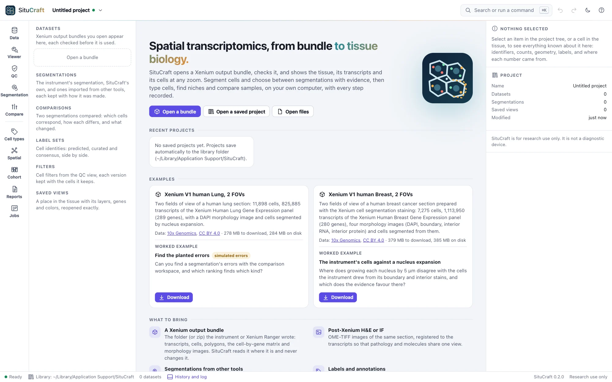
</picture>

Under **Examples**, two public Xenium bundles from 10x Genomics (CC BY 4.0) are ready to download,
and a simulated tissue is ready to make:

| Example | Download | On disk | What it shows |
| --- | --- | --- | --- |
| Xenium V1 human Lung, 2 FOVs | 278 MB | 284 MB | 11,898 cells, 825,885 transcripts, 289 genes, a DAPI image, nucleus-expansion segmentation |
| Xenium V1 human Breast, 2 FOVs | 379 MB | 385 MB | 7,275 cells, 1,113,950 transcripts, 280 genes, four stains, multimodal cell segmentation |
| A simulated tissue with known truth | none: made here in seconds | 42 MB | 3,030 cells of four types, 436,996 transcripts, 120 genes, a DAPI image, nucleus-expansion segmentation, an H&E and an immunofluorescence image of the section stained after the run, and the truth: every cell's, transcript's and type, and where each image's pixels lie |

**Download** fetches one from 10x Genomics, checks the archive and every file against recorded
checksums, keeps only the bundle and deletes the archive. Nothing is downloaded until you ask.
**Make it** simulates the third with SituCraft's standard settings (`situcraft simulate
--post-xenium` makes the same tissue, byte for byte); it is labeled simulated wherever it is shown.
One made by an earlier SituCraft, without the H&E, offers **Make it again**: the same run, cells
and transcripts, with the images.
When a 10x Genomics example is ready, **Take the tour**: seven steps through the Data view, the Viewer and QC. Use
**Next** and **Back** on the card at the foot of the window; you can explore at any step, and the
tour continues from there.

<picture>
  <source media="(prefers-color-scheme: dark)" srcset="images/tour-dark.webp">
  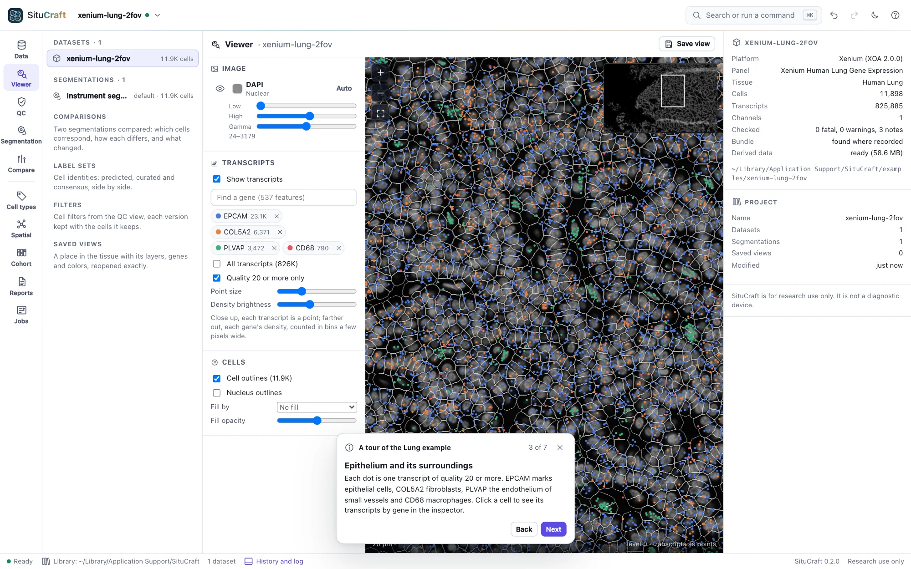
</picture>

Each example is used under its license; its source and license are linked on its card, and the
methods paragraph (section 7) cites it.

Each example also has **worked examples**: a question answered step by step, saying first what to
expect. Some steps run a job before going on (the card's button says what it does: expand the
nuclei, plant errors, refine, import the truth, compare, cluster, label, make the labels again on
another segmentation, add the H&E, place landmarks, align it automatically, check its alignments,
draw regions and write them for QuPath, decide the review queue's first cells, exclude a fold), and
others open the comparison in the Compare workspace, the clustering in the Cell types view, the
Alignment view, or the Viewer, with the view, the ranking, the colors and the difference the step
talks about.

| Example | Worked example | The question |
| --- | --- | --- |
| Breast | The instrument's cells against a nucleus expansion | Where does growing each nucleus by 5 µm disagree with the cells the instrument drew from its stains, and which does the evidence favor there? |
| Breast | Redraw the cells from their transcripts | How does SituCraft's transcript-informed segmentation redraw the instrument's cells, and where is it unsure of itself? |
| Breast | Labels under two segmentations | How much do the cells' labels depend on the segmentation they were counted in, and which cells does the choice change? |
| Lung | Find the planted errors (simulated) | Can you find a segmentation's errors with the comparison workspace, and which ranking finds which kind? |
| Lung | Cluster and label the Lung cells | Which cells are in this section, as their expression groups them and as known markers name them, and how far can each label be trusted? |
| Simulated | Score segmentations against the truth | When every cell is known, how close do the instrument's nucleus expansion and SituCraft's transcript-informed segmentation come to the true cells? |
| Simulated | Labels against the truth | When every cell's type is known, how many cells do markers label correctly, and how much of the error is the segmentation's? |
| Simulated | Align an H&E three ways | The section was stained with H&E and scanned after the run: placed by Xenium Explorer's matrix, by six landmarks, or automatically by the nuclei, which places it best, and how do you tell without a truth? |
| Simulated | Regions for QuPath | Draw the epithelial and the immune domains on the H&E, count their cells, and take the regions to QuPath in the H&E's own pixels: do they come back as they were? |
| Simulated | A pathologist's review | Labels from markers are predictions. Which cells should a pathologist look at first, what do the decisions change, and what does the record keep of each? |

<picture>
  <source media="(prefers-color-scheme: dark)" srcset="images/worked-dark.webp">
  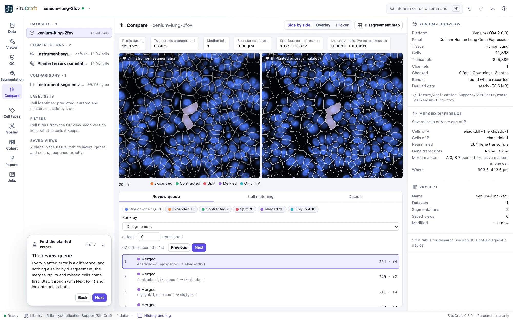
</picture>

<picture>
  <source media="(prefers-color-scheme: dark)" srcset="images/worked-labels-dark.webp">
  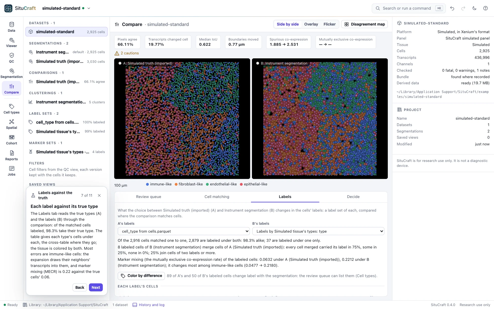
</picture>

## 3. Open your own bundle

A Xenium output bundle is the folder the instrument or Xenium Ranger wrote, holding
`experiment.xenium`, `transcripts.parquet`, `cells.parquet`, the boundaries, the cell-feature
matrix and the morphology images. SituCraft opens it as:

- its folder, its `experiment.xenium` file, or a `.zip` of it;
- on the command line, `situcraft /path/to/output-XETG00000__0000000__Region_1__20240101__000000`
  (several bundles, or a folder of them, at once);
- or **Open a bundle** in the window (⌘O or Ctrl+O), typing or pasting its path.

SituCraft reads a bundle where it is, and never changes, moves or copies it. Running `situcraft
<paths>` while SituCraft is open hands them to the open window.

## 4. Check it: the Data view

<picture>
  <source media="(prefers-color-scheme: dark)" srcset="images/data-dark.webp">
  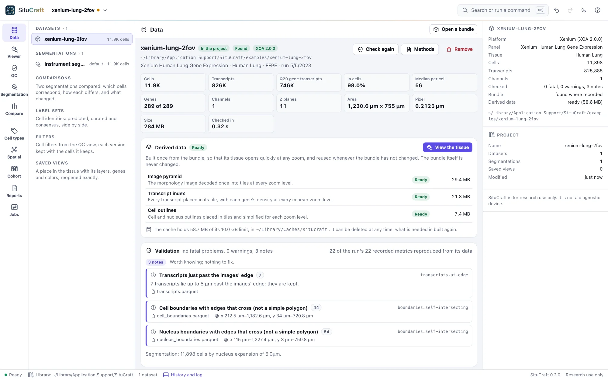
</picture>

The Data view says what the bundle is (instrument software and version, panel, tissue, cells,
transcripts, channels) and how far SituCraft supports it: Xenium Onboard Analysis 2.x fully,
other versions best-effort, said so.

It then checks the bundle. Each finding is:

- **fatal:** the bundle cannot be used until it is fixed (a missing or unreadable file);
- **a warning:** usable, but it may bias an analysis;
- **a note:** worth knowing, nothing to fix.

Each finding names its files, how many records it concerns, where in the tissue, and what to do.
SituCraft also recomputes 20 of the run's recorded metrics and 2 values of its manifest from the
data and says whether they agree.

**Add to project** records a bundle with no fatal finding in the current project. SituCraft then
builds its *derived data* once (image tiles at every zoom, a spatial index of the transcripts, tiled
cell outlines): a few seconds for the examples, shown with its progress. They are kept in the cache
and reused whenever the bundle is unchanged; they can be deleted at any time and are rebuilt when
needed. **View the tissue** opens the Viewer.

## 5. See the tissue: the Viewer

<picture>
  <source media="(prefers-color-scheme: dark)" srcset="images/viewer-genes-dark.webp">
  
</picture>

- **Move:** drag to pan; scroll, pinch, **+** and **−**, or double-click to zoom; **0** shows the
  whole tissue; the minimap (top right) jumps to a place. The scale bar and position are in µm.
- **Image:** each morphology stain with its color, brightness window (**Low**, **High**, or
  **Auto**) and gamma; the eye shows or hides it.
- **Transcripts:** type a gene's name to show its transcripts (up to 16 genes, each in its color),
  or show all transcripts. Up close each transcript is a dot; farther out, each gene's density.
  **Quality 20 or more only** keeps the transcripts Xenium counts.
- **Cells:** cell and nucleus outlines (drawn once cells are large enough to see), and cells filled
  by their transcripts, area or segmentation method, with a legend.
- **Segmentation:** any of the dataset's segmentations, chosen in the Cells layer (its default
  first); the legend says how it was made. A transcript-informed one also fills its cells by the
  limitations it flagged, its boundary certainty or its assignment certainty, and colors its
  transcripts, close up, by their probability of their cell: doubtful ones bright, certain ones
  dark. **Show on the tissue**, beside a segmentation in the Segmentation view or the inspector,
  opens it here.
- **A cell:** click it to see its ID, position, areas, segmentation method and genes in the
  inspector (right); **Esc** clears it. In another segmentation than the instrument's, the
  inspector also says which instrument's cell it came from and how sure the segmentation is of
  it.

<picture>
  <source media="(prefers-color-scheme: dark)" srcset="images/refined-dark.webp">
  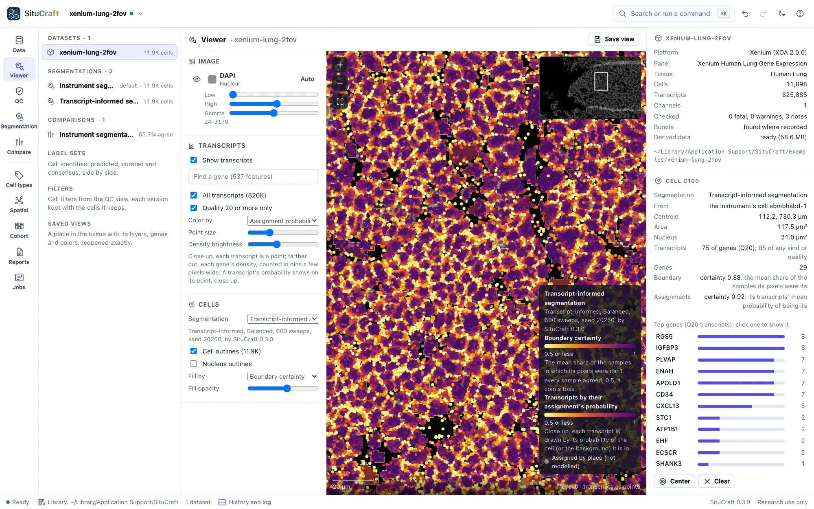
</picture>

**Save view** keeps exactly what the Viewer shows: the place and zoom, the stains and their
settings, the genes, the layers, the segmentation and the selected cell. Saved views are listed in the project tree
(left) and the command palette (⌘K or Ctrl+K). Select one to reopen it; in the inspector, **Copy
link** gives a link that reopens it, **Rename** and **Remove** change it.

## 6. Check quality: the QC view

<picture>
  <source media="(prefers-color-scheme: dark)" srcset="images/qc-dark.webp">
  
</picture>

- **Run metrics:** every metric the run recorded, explained, with SituCraft's own value beside the
  recorded one where it can be recomputed (**Reproduced**), or why not.
- **Maps over the tissue:** cells colored by an attribute (gene transcripts, genes detected,
  area, negative controls, segmentation method and more), or small regions colored by the share of
  transcripts outside cells, the share below quality 20, or negative-control density.
- **Plots:** a histogram, box plots by segmentation method, and a scatter plot. Drag across a plot
  to choose cells; they light up in the tissue (here and in the Viewer) and the inspector compares
  them with all cells.
- **Filters:** conditions on cells (for example, gene transcripts at least 20 and area 15 to 400
  µm²), each condition's effect counted as you edit it. **Save version** keeps the filter as a numbered
  version in the project, with the count and a checksum of the cells it keeps; it is checked to
  keep the same cells whenever the project reopens (**Reproduced**). Filters never change the data.

<picture>
  <source media="(prefers-color-scheme: dark)" srcset="images/qc-filter-dark.webp">
  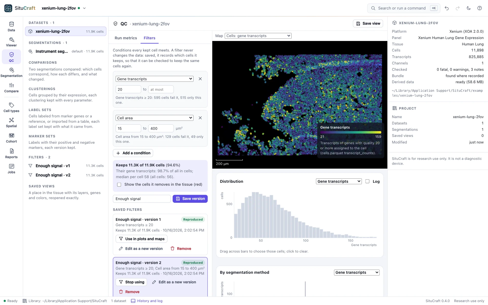
</picture>

**Save view** in the QC view keeps the map, the filter in use and the place.

## 7. Keep and share the record

<picture>
  <source media="(prefers-color-scheme: dark)" srcset="images/saved-views-dark.webp">
  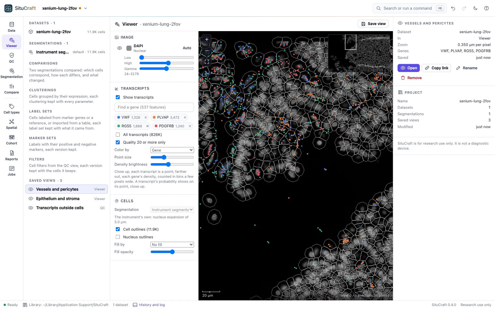
</picture>

- **Projects save themselves** to the library as you work; the start page and the project menu
  (the project's name, top left) reopen them. **Undo** and **Redo** (⌘Z, ⇧⌘Z) cover every change,
  and the drawer (⌘J) shows the project's history and the session's log.
- **A bundle that moved:** reopening a project finds each bundle where it was recorded. If it is
  gone, **Locate…** in the Data view points to its new place, once SituCraft has checked it is the
  same run.
- **Methods:** **Methods** in the Data view writes a paragraph for the dataset from what the project
  records: the platform, panel and software, the segmentation, the transcripts counted, how
  SituCraft checked the bundle (with its version and commit), the filters you choose, and the data's
  source, with references. **Copy** puts it on the clipboard; read it against what you did and add
  what was done elsewhere.
- **Project archives:** **Project archive (.scz)…** in the project menu writes the project
  (datasets, filters, saved views, history) to a file you name. It does not contain the bundles:
  it records each one relative to the archive, so a folder holding the archive and its bundles can
  be moved, copied or shared, and opened with `situcraft project.scz` or **Open a bundle**.

## Segmentations and jobs

When a dataset is added, SituCraft registers the instrument's segmentation as an artifact: the
cells, their boundaries, the nuclei, the transcripts' assignments and the counts, each file recorded
by its SHA-256 (it stays in the bundle). Under **Segmentations** in the project tree, the default
one is marked; the inspector shows how it was made (the methods and how many cells each found), its
files, what its check found, and why it is the default.

<picture>
  <source media="(prefers-color-scheme: dark)" srcset="images/expansion-dark.webp">
  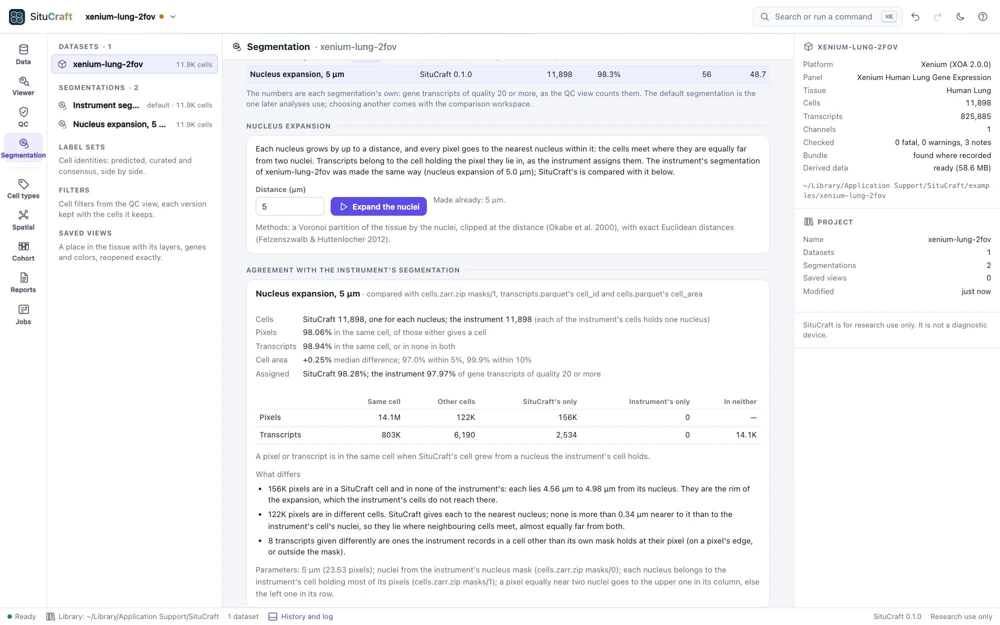
</picture>

The **Segmentation** view lists the dataset's segmentations side by side, with their cells, the
share of gene transcripts each assigns, transcripts per cell and cell area. **Expand the nuclei**
grows each nucleus by the distance you choose (5 µm, Xenium's default, to start) into a cell of its
own: every pixel goes to the nearest nucleus within the distance, and transcripts to the cell
holding the pixel they lie in. It runs as a job (about a second for the Lung example) and becomes a
segmentation of its own, kept with its parameters. Below, it is compared with the instrument's
segmentation pixel by pixel and transcript by transcript, and what differs is described: on the
Lung example, segmented by the instrument the same way, 98.06% of pixels and 98.94% of transcripts
are in the same cells.

**Transcript-informed segmentation** redraws each cell from the transcripts (SituCraft's
implementation, after Jones et al. 2025). It starts from the instrument's cells and their nuclei.
Each boundary moves to where the cell's own transcripts are, and each transcript may have drifted
from the cell it came from. Its studio takes you through six steps, each showing what the run
would do on this bundle and this computer:

<picture>
  <source media="(prefers-color-scheme: dark)" srcset="images/studio-dark.webp">
  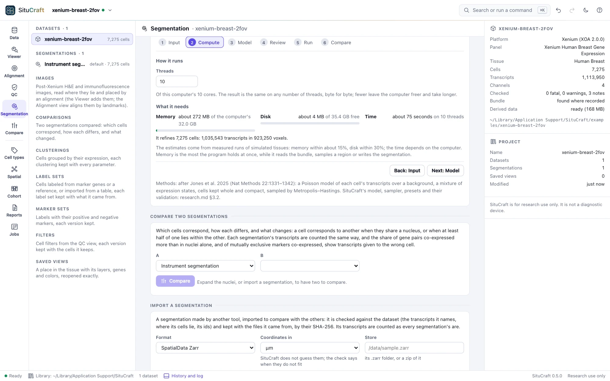
</picture>

1. **Input:** the transcripts' quality (Q20 to start), the cells it starts from, and what it
   covers: the whole tissue, its separate sections apart, or chosen regions (typed in µm, or the
   region last framed in the Viewer). Outside a region the instrument's cells stay as they are.
2. **Compute:** the threads, and the memory, disk and time it needs against what the computer
   has.
3. **Model:** a preset (Balanced, Conservative boundary, Flexible morphology, Low memory, ROI pilot,
   Expert), what it changes and what it risks, and every setting with what it does and costs.
4. **Review:** what will run, anything that stops it (with what to do) and its risks; **Refine**
   starts it, and **Save the recipe** keeps its settings as a file, to run again here or with
   `situcraft refine` in a terminal.
5. **Run:** its progress and log, and **Stop**. A failure says what went wrong and what to do.
6. **Compare:** whether it settled, which cells its result is least sure of (few transcripts,
   uncertain boundaries, no nucleus), and, for an ROI pilot, how often a second seed put the
   transcripts in the same cells. **Review the differences** opens the comparison workspace on it
   against the instrument's segmentation, made as soon as the refinement is.

The ROI pilot is the place to start on a new tissue: a region of a few hundred µm takes seconds,
and its two seeds show how much of the result is chance. The result itself is the summary of many
samples from the model: each transcript in its most probable cell, with that probability kept.

A large tissue (more than about 4 million transcripts modeled) is refined in patches of about 2
million transcripts each, one after another, each also refining the cells within 40 µm of its
square, and stitched into one segmentation; the Compute step says how many. The result is the same
for the same seed whatever the computer. The memory still grows with the tissue, by about 100
bytes a transcript: a tissue of 55 million transcripts needed 5 to 6 GB.

<picture>
  <source media="(prefers-color-scheme: dark)" srcset="images/import-dark.webp">
  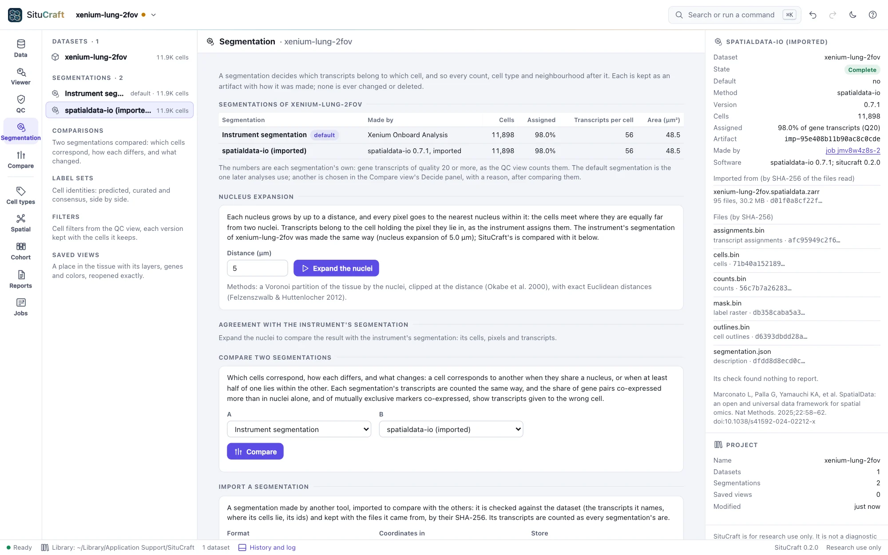
</picture>

<picture>
  <source media="(prefers-color-scheme: dark)" srcset="images/comparison-dark.webp">
  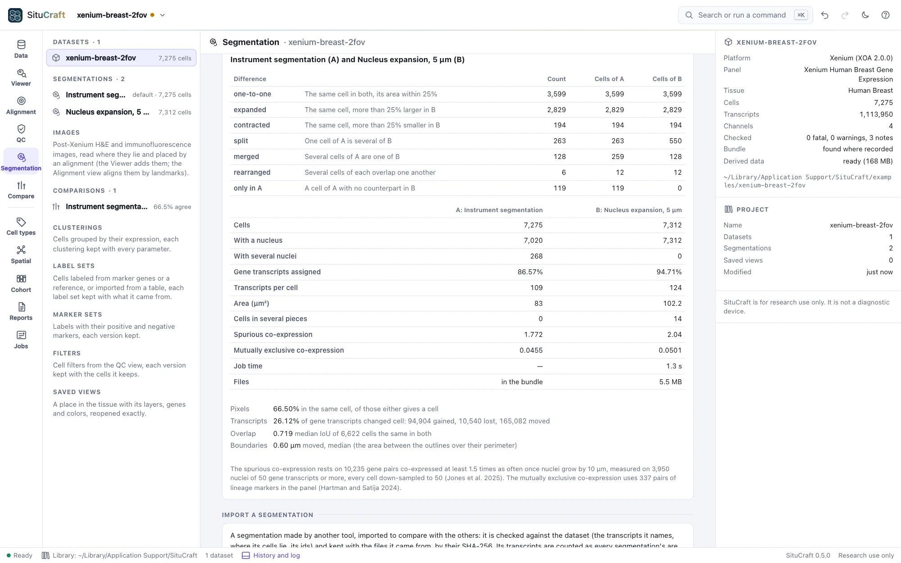
</picture>

**Compare two segmentations** chooses an A and a B and shows which cells correspond and how each
differs: one-to-one, expanded or contracted (by more than 25% of its area), split, merged,
rearranged, or only in one. Two cells correspond when they share a nucleus, or when at least half
of one lies within the other. Beside each segmentation's own numbers (cells, cells with a nucleus,
assigned transcripts, transcripts per cell, areas), two measure transcripts given to the wrong
cell: the spurious co-expression of gene pairs relative to nuclei alone (Jones et al. 2025; 1 is
as in nuclei), and how often markers of different lineages are found in the same cell (the
mutually exclusive co-expression rate of Hartman and Satija). Between the two, the pixels that
agree, the transcripts that changed cell, and how far the boundaries moved. The comparison runs
as a job and is kept with the project. One you no longer need can be removed from the project
(**Remove** in the inspector): the two segmentations stay, and it can be made again at any time.
A comparison a decision rests on stays, since the methods paragraph tells how the default was
chosen from it. A comparison made by an earlier SituCraft whose list of differences this version
does not read says so, and offers to compare the two segmentations again.

<picture>
  <source media="(prefers-color-scheme: dark)" srcset="images/workspace-dark.webp">
  
</picture>

**Open** (beside a comparison, or **Compare** in the views) shows the two on the tissue:

- **Side by side** with one camera, **Overlay** (B's outlines over A's, each in its color), or
  **Flicker** (A and B in turns). Cells are filled by the class of their difference; the
  **Disagreement map** shades each 50 µm region by the share of its pixels the two give to
  different cells.
- **The review queue** ranks the differences by reassigned transcripts, contamination (pairs of
  markers of different lineages found in one cell of B and not of A), disagreement or low counts,
  among the classes you keep and with at least the reassigned transcripts you set. **Next** and
  **Previous** (or `]` and `[`) go through it; each difference opens where it lies, its cells lit
  in both, and is described in the inspector. **Cell matching** lists every difference, sortable.
- **Labels** reads a label set of each segmentation through the comparison: what the choice
  changes in the cells' labels (below, Labels under two segmentations).
- **Decide** promotes one segmentation as the dataset's default, keeps one for exploration, or
  rejects one, with a reason. Decisions are appended to the project with the comparison they rest
  on and never removed; the default cannot be rejected until another is promoted, and no
  segmentation is ever deleted.

The measures' header says when one rests on little (few nuclei for the spurious co-expression,
few marker pairs in the panel, cells without outlines).

**Import a segmentation** brings in one made by another tool: a SpatialData Zarr store, Baysor's
`segmentation.csv` with its polygons, GeoJSON polygons with an optional transcript table (CSV or
Parquet), or a Xenium Ranger output bundle of the same run. Say whether its coordinates are in µm
or in pixels of the morphology image (stores written by spatialdata-io from Xenium data are in
pixels): SituCraft does not guess, and the import's check says when the cells do not lie within
the dataset's image. It also checks that the transcripts it names are the dataset's. The import
runs as a job and becomes a segmentation of its own, kept with the SHA-256 of every file it read,
its transcripts counted as every segmentation's are; one whose check finds a fatal problem is
kept as invalid, for review.

**Practice: find planted errors**, on the example datasets, makes a copy of the instrument's
segmentation with known errors in it: neighboring cells of different lineages merged, large cells
split in two, cells missed, and cells drawn too wide. Compare it with the instrument's, review the
differences in the workspace, then open **The answer key** to see what was planted where (**Show**
takes you to each). The copy is simulated, named so, and is never promoted or exported. On the Lung
example, the comparison lists exactly the 60 planted errors, each in its class, and ranked by
contamination the merges come first: their cells express markers of two lineages together. To
practice on a dataset of your own, turn on **Practice tools for every dataset** in the menu of the
theme button (top right); it is off unless you do.

### Export a segmentation

<picture>
  <source media="(prefers-color-scheme: dark)" srcset="images/export-dark.webp">
  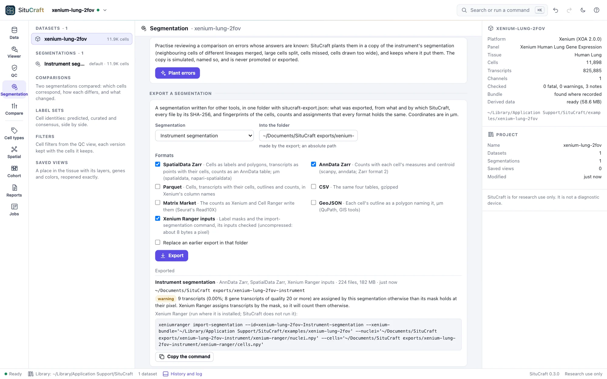
</picture>

**Export a segmentation** writes any of a dataset's segmentations for other tools, into one folder
you name:

| Format | For | Holds |
| --- | --- | --- |
| SpatialData Zarr | spatialdata, napari-spatialdata | The cells as a label image and as polygons, the transcripts as points with their cells, the counts as an AnnData table |
| AnnData Zarr | scanpy, anndata | The counts, with each cell's measures and centroid |
| Parquet; CSV | DuckDB, pandas, R, polars | Cells, transcripts with their cells, outlines and counts, in Xenium's column names |
| Matrix Market | Seurat (`Read10X`), scanpy | The counts as Xenium and Cell Ranger write them |
| GeoJSON | QuPath, GIS tools | Each cell's outline as a polygon naming it |
| Xenium Ranger inputs | Xenium Ranger's `import-segmentation` | The cells and nuclei as label masks on the morphology image's pixels, and the command |

Coordinates are in µm. Beside the files, `situcraft-export.json` says what was exported, from what
and by which SituCraft, lists every file by its SHA-256, and gives fingerprints of the label image,
the counts and the transcripts' cells that every format holds the same (`docs/FORMATS.md`), so that
you can check any reader got it exactly. The export runs as a job, is written under a temporary
name and renamed into place when complete, and is recorded in the project. A folder that exists is
replaced only when you ask, and only when it is an earlier SituCraft export.

For **Xenium Ranger**, SituCraft prepares the inputs and the command, and does not run it. It
checks first that the masks are the morphology image's size, which cells have no pixel (Xenium
Ranger cannot keep them), and how many transcripts this segmentation assigns otherwise than its
mask holds at their pixel (Xenium Ranger assigns by the mask). **Copy the command** puts it on the
clipboard to run where Xenium Ranger is installed.

<picture>
  <source media="(prefers-color-scheme: dark)" srcset="images/jobs-dark.webp">
  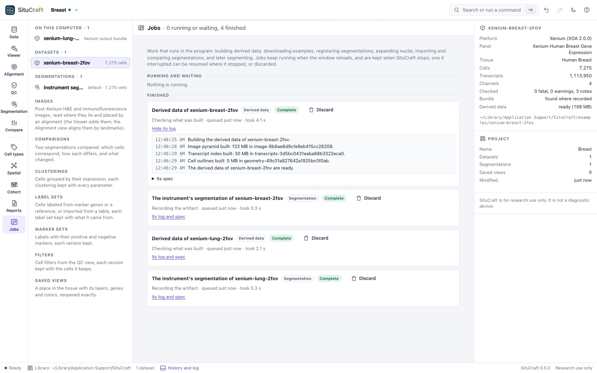
</picture>

Long work runs as a job: building derived data, downloading an example, registering a
segmentation, expanding nuclei, importing, comparing or exporting segmentations, planting errors,
clustering cells, mapping them, adding the instrument's clusters.
The **Jobs** view shows what runs and waits, what finished, and each job's log and spec. Jobs keep
running when the window reloads, and closing the window while one runs asks first. If SituCraft
stops (or the computer does) in the middle of a job, the job is shown as interrupted
when SituCraft starts again: **Resume** continues it where it stopped, **Discard** forgets it.

## Cell types: clusters

The **Cell types** view groups a segmentation's cells by their gene expression, the first step
toward naming them. Choose the segmentation (the default to start) and the cells to analyze: those
with at least 10 gene transcripts, or, for the instrument's segmentation, the cells one of your QC
filters keeps. **Cluster the cells** runs the common single-cell workflow as a job (about a second
for the examples):

1. each cell's counts scaled to the median total and log-transformed;
2. each gene scaled, so that every gene counts alike;
3. principal components (50), computed exactly;
4. each cell's 15 nearest neighbors in them, as a graph;
5. Leiden communities of the graph: the clusters, numbered from the largest.

The same steps serve a whole section: above 50,000 cells the nearest neighbors are found by
NN-Descent rather than by comparing every pair (the clustering says how many of the exact
neighbors it found, measured on 1,000 of its cells: 99.9% on the examples), the map is laid out
over every core, and for panels of more than 1,000 genes (Xenium Prime) the components are found by
the Lanczos method, the full decomposition's to rounding.

**Parameters** shows each setting with what it does. They are scanpy's defaults, so the numbers
match what the scanpy tutorials give. **Resolution** is the one you will change most: higher gives
more and smaller clusters. There is no right value; make a few and compare their markers. Each
clustering is kept as an artifact of its segmentation with every parameter and its seed, and the
same seed gives the same clusters on any computer. Asking for one already made answers it at once.

<picture>
  <source media="(prefers-color-scheme: dark)" srcset="images/celltypes-dark.webp">
  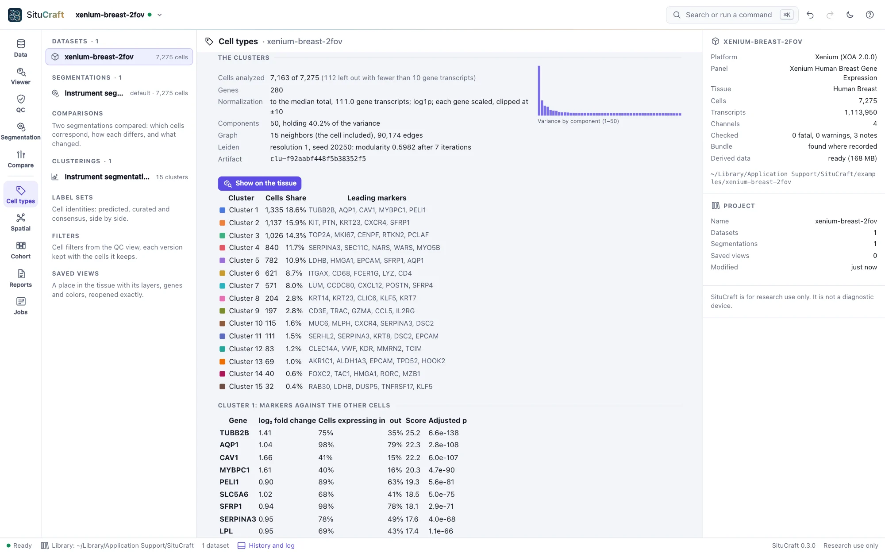
</picture>

Under each clustering are its numbers (the cells analyzed and left out, the components' share of
the variance, the graph and the modularity Leiden reached) and its clusters, each with its size
and leading markers. Choose a cluster to see its markers against all the other cells: how much
higher its expression is (log₂ fold change), the share of cells expressing the gene in and out of
it, and the rank-sum test's score and adjusted p-value. These are exploratory: the cells of one
tissue are not independent replicates, so the p-values rank genes rather than test them.

**Show in the Viewer** opens the Viewer with the cells filled by cluster and a legend. The Viewer's
**Fill by** lists every clustering of the segmentation drawn, and a saved view keeps the one shown.

<picture>
  <source media="(prefers-color-scheme: dark)" srcset="images/clusters-dark.webp">
  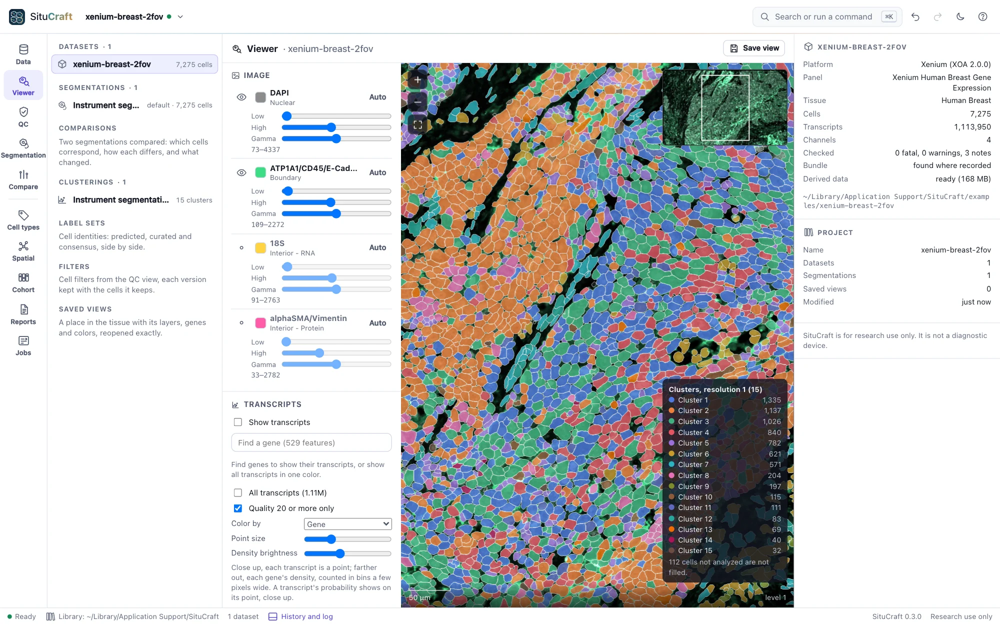
</picture>

### The map and the tissue

<picture>
  <source media="(prefers-color-scheme: dark)" srcset="images/cellmap-dark.webp">
  
</picture>

Each clustering comes with a **map** (UMAP, made at once, a few seconds for the examples): cells
with similar expression lie near each other. It sits beside the tissue, and the two are linked:
- **Color by** a clustering's clusters (any clustering of the segmentation), a gene (type its
  name), the cells' gene transcripts or area, or how faithfully the map keeps each region's
  neighbors.
- **Select cells** on either side with the **Lasso** (shift adds to the selection), or by clicking
  a cluster in the legend or the table: the cells are selected on both, the others faint. Click a
  cell on the map to find it on the tissue, or on the tissue to mark it on the map.
- **Markers of the selection** compares the selected cells with the clustering's other cells, as the
  clusters' markers are computed: what distinguishes a region you drew.

A map shows which cells are alike, not how alike: distances between groups, and their sizes, mean
little. Under the map, SituCraft says how far this one can be trusted, from its trustworthiness and
how many of each cell's nearest neighbors in expression stay near it on the map.

**Name** clusters in the table (a T-cell cluster, a tumor cluster): names show on the map, the
tissue and the legends, and giving several clusters the same name merges them. Each change is a
new version of the names, kept in the project's history; the clusters keep their numbers. The
**dot plot** shows each cluster's two leading markers across all clusters: dot size, the share of
cells expressing the gene; color, its mean expression.

**The instrument's clusters:** the bundle holds the instrument's own analysis (graph-based clusters,
and k-means for 2 to 10 clusters, with its own map). **Add** one to explore it here like any
clustering (SituCraft computes its markers), and the instrument's map comes with the first.
**Two clusterings compared** cross-tabulates any two clusterings of the same cells, with the
adjusted Rand index (1: the same partition; about 0: as alike as chance).

## Cell types: labels from markers

Under a clustering, **Labels from markers** labels each cell from the genes known to mark cell
types. A **marker set** is a hierarchy of labels (a class such as Immune, a lineage such as T cell,
a subtype such as CD8 T cell) and states (Proliferating), each with **positive** markers, the genes
its cells express, and **negative** ones, genes they do not. SituCraft offers a starter set for
each example's panel, from published breast and lung cell atlases (the **Sources**), every marker
in the panel.

<picture>
  <source media="(prefers-color-scheme: dark)" srcset="images/labels-dark.webp">
  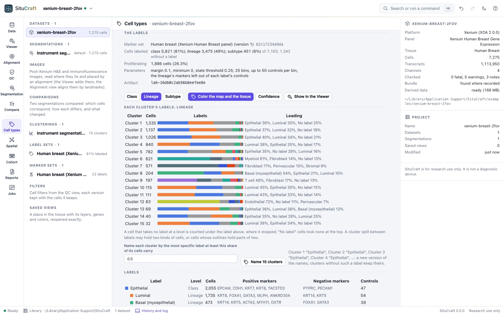
</picture>

**Label the cells** scores each cell for each label: its markers' expression less that of control
genes of similar average expression (as scanpy's `score_genes` scores a gene list), its negative
markers counting against it where the cell expresses them. Labels are then taken from the top
down: a cell takes the best class when it leads the next by the **margin**, then the best of that
class's lineages, and so on; where no label leads, the cell stays at the level above, so a T cell
whose CD4 and CD8 markers are both faint stays a T cell. Each cell's **confidence** is how far its
label led. A label set is kept as an artifact with the marker set it came from and every
parameter; asking again answers it.

Under the labels:
- **Each cluster's labels** at the level chosen (Class, Lineage, Subtype), as bars. A cluster split
  between labels may hold two kinds of cells, or cells whose outlines hold parts of two.
- **Name the clusters** by the most specific label at least half (or a share you choose) of each
  cluster's cells carry: a new version of the names, which you can edit. Clusters given the same
  name merge on the map and the tissue.
- **Color the map and the tissue** by the labels, their confidence, or one label's score (choose it
  in the labels' table, which lists each label's markers and control genes). The Viewer's **Fill
  by** lists each label set's levels.

**Edit** the marker set to add labels, levels or states, or change markers (the panel's genes are
offered as you type, and those it lacks are marked). Saving makes a new version, kept with the
earlier ones and the labels made from them. **Save as a file** writes the set as JSON, and **Read
a file…** reads one (`docs/FORMATS.md`); a set naming genes the panel lacks offers to remove them.

Starter sets are a starting point. Markers that hold in an atlas may not in your tissue (in the
Breast example the tumor cells express LPL, an adipocyte marker), and in a tissue one type
dominates, its own markers score low against control genes that are mostly its other genes, so
many of its cells may stay without a label. Check each cluster's labels against its markers before
naming it.

### Labels from a reference

When a labeled single-cell dataset of the same tissue exists (an atlas, or your own single-cell
experiment), **Labels from a reference** labels each cell by the reference label it most resembles.
Name the reference (its path on this computer) and **Read** it: an AnnData object saved with
`write_zarr` (a `.zarr` folder, or a zip of one), whose cells carry their labels in an `obs` column,
or a table of each label's mean expression (CSV, TSV or Parquet, a row per label or per gene). An
`.h5ad` file is written as Zarr in one line of Python:
`anndata.read_h5ad("reference.h5ad").write_zarr("reference.zarr")`.

<picture>
  <source media="(prefers-color-scheme: dark)" srcset="images/reference-dark.webp">
  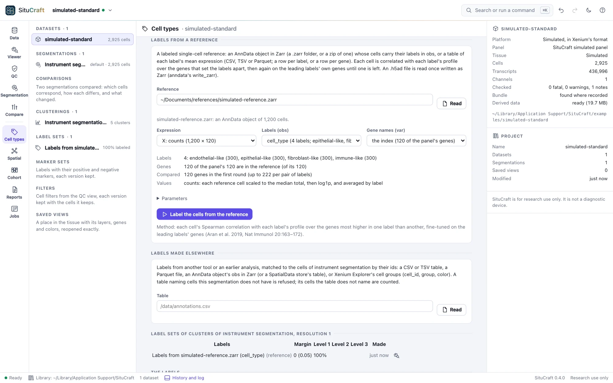
</picture>

SituCraft suggests the reference's expression (counts preferred), its column of labels and its
column of gene names, and says what it found: its labels and their cells, how many of the panel's
genes it has (and which it lacks: if it has few, check that its genes are named by symbol, and the
species), and how many will be compared. **Label the cells from the reference** then correlates
each cell with each label's profile (its reference cells' mean expression) over the genes that set
the labels apart, and scores the leading labels again on their own genes until one is left (as
SingleR does, Aran et al. 2019). Each cell's **confidence** is how far its label led the next, in
correlation. The label set is kept with the reference as it was compared and its SHA-256.

The labels follow the reference: a reference of other cells (an atlas of healthy tissue for a
tumor, say) gives each cell the nearest label it has, which may be wrong. The evidence card (below)
shows, for each cell, how close the leading labels were and which genes set its label apart from
the next. To try it, `situcraft simulate --reference 300 <folder>` writes a simulated tissue and a
reference of its types beside it.

### Labels made elsewhere

Labels from another tool or an earlier analysis (a colleague's annotation, a reference mapping,
the instrument's clusters) are imported under **Labels made elsewhere**, for the segmentation's
cells. Name the table (its path on this computer) and **Read** it: a CSV or TSV file, a Parquet
file, an AnnData object saved with `write_zarr` (or a SpatialData store), or Xenium Explorer's cell
groups. SituCraft lists the columns and suggests which holds the cells' ids, which their labels,
and, optionally, a confidence and colors; change them if they are wrong. Before you import, it
says how the ids match: a table naming cells this segmentation does not have is refused (its labels
were made for another segmentation, or another sample), and the cells it does not name will have
no label. **Or the instrument's clusters** imports one of the instrument's clusterings as labels.

<picture>
  <source media="(prefers-color-scheme: dark)" srcset="images/imported-dark.webp">
  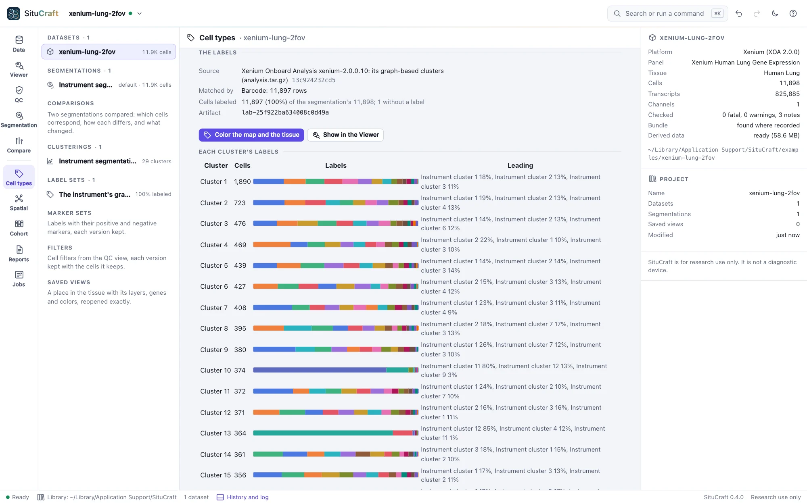
</picture>

An imported label set is shown like one from markers: each cluster's labels (here, how SituCraft's
clusters of the Lung example split among the instrument's), names for the clusters from them, the
map, the tissue and the Viewer colored by them, and a label's cells selected when you choose it.
Its file is recorded by its SHA-256, so the project says exactly what was imported.

### Reviewing labels

Labels are predictions. Under **Label versions** each label set of the segmentation is listed:
from markers or a reference, imported, curated and consensus. **Curate** begins a curated set from a predicted one:
its labels, with your changes appended, each with its reason, who made it and when (the predicted
set stays as the method made it). **Make a consensus…** combines sets by a rule: unanimous (every
set gives the label), majority (at least so many sets, more than any other label) or in order (the
first set's label, else the next's); labels the sets name differently can be mapped to a common
name. Any two versions are compared **side by side** in a table of their labels.

<picture>
  <source media="(prefers-color-scheme: dark)" srcset="images/review-dark.webp">
  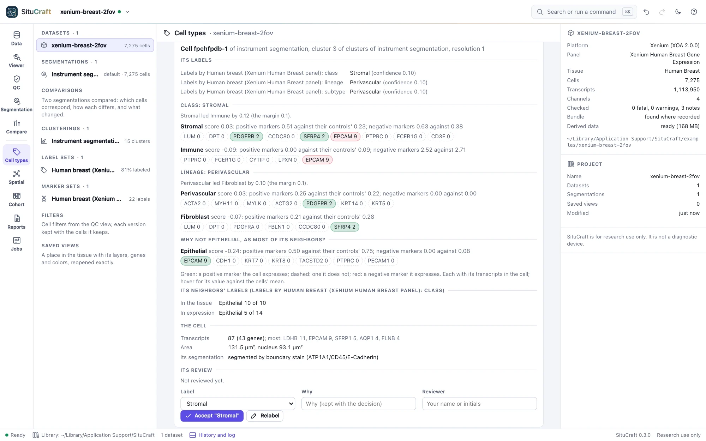
</picture>

**Review** ranks the cells to look at first: those whose label few of their nearest cells in the
tissue share while most share another (a lone label among others is often a mislabel, two cells in
one outline, or a cell at a boundary), those whose label changes under another segmentation (choose
the label set of it in **Label changes against**; below), and those of low confidence. Choose a
cell, in the list or on the map or the tissue, to see its **evidence**: its label in every version;
for labels from markers, why it took its label and not the next, gene by gene in the cell (green, a
marker it expresses; red, a negative marker it expresses), and why not the label its neighbors
carry; for labels from a reference, each round's correlations and the genes higher in its label's
profile and in the next's that the cell expresses; what its counterparts carry under the other
segmentation; its neighbors' labels in the tissue and in expression; its transcripts and its
segmentation's flags. **Accept** its label or **Relabel** it, saying why (or mark it ambiguous,
exclude it, record a segmentation concern, comment); the decision is recorded as a review
(**Reviewing cells and regions**, below), a relabel added to a curated set, and the next cell is
shown.

### Labels under two segmentations

Cell types are read from cells, so the segmentation chosen can change them: a cell drawn too wide
takes its neighbor's transcripts and may take its neighbor's label; a cell split in two may become
two kinds. To see how much, compare two segmentations (Segmentation view), then, under a
clustering's label sets, **Make this clustering and its label sets again on** the other
segmentation: the clustering with the same parameters, its map, and each label set from markers or
a reference, in one step (imported labels belong to their segmentation's cells and are not made
again; a QC filter's cells are the instrument segmentation's, so the cells are then those with
enough transcripts).

<picture>
  <source media="(prefers-color-scheme: dark)" srcset="images/impact-dark.webp">
  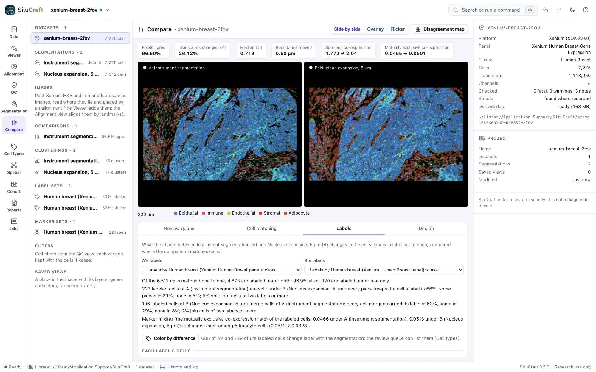
</picture>

The comparison's **Labels** tab (Compare workspace) reads a label set of each segmentation through
the comparison (by default two made the same way, at their first level):
- **How many cells keep their label:** of the cells matched one to one, the share labeled alike,
  and every change (T cell → Macrophage, and so on); what split cells' pieces carry (the cell's
  label, some of them, or none) and what merged cells carried.
- **Each label's cells** under each segmentation, and the change in its share.
- **Marker mixing by label:** of each label's cells, the share expressing two mutually exclusive
  markers together, and the mutually exclusive co-expression rate among them. Under a segmentation
  that gives cells their neighbors' transcripts, it rises.
- **The differences whose labels change,** the most transcripts reassigned first; each opens where
  it lies. **Color the cells by their labels** fills each side's cells with its labels' colors.

The cells whose label changes are segmentation-sensitive: the review queue lists them when you
choose the other segmentation's label set in **Label changes against**, with what their
counterparts carry.

## Post-Xenium images: H&E and immunofluorescence

A Xenium run leaves the section intact, so it can be stained (H&E) or imaged for proteins
(immunofluorescence) afterwards. SituCraft draws such an image on the tissue, under the
transcripts and cells, placed by an alignment to the Xenium image. To practice, the simulated
example has both (in its `post_xenium` folder, the matrix in its truth), and its worked examples
align the H&E, draw regions on it and review cells against it.

In the Viewer, open **Post-Xenium images**, then **Add a post-Xenium image**:

1. **Image:** the path of the OME-TIFF. SituCraft reads pyramidal, tiled OME-TIFFs, as Xenium
   Explorer does; a flat image is refused with how to make one (10x's image conversion guide, or
   `bfconvert -pyramid-resolutions 6 -pyramid-scale 2 -tilex 1024 -tiley 1024`).
2. **Check:** says what the image is (RGB or its channels, its size and levels, its compression)
   and fills in the alignment when one named after the image lies beside it, as 10x names them
   (`<sample>_he_imagealignment.csv` for `<sample>_he_image.ome.tif`).
3. **Alignment (optional):** the transformation matrix or the keypoints Xenium Explorer saves (its
   **Download Image Alignment File**). Without one, the image is added unaligned, to place by
   landmarks. An image is placed by an alignment alone: the pixel size its own metadata gives is
   often the Xenium image's, whatever its own.
4. **Add the image:** a job checksums the image where it lies (it is never copied) and records it
   as an artifact of the dataset, with its alignment as the first version of it.

Each image is listed under **Images** in the project tree and in the Viewer's panel, with the
version of its alignment that places it (its scale, its turn, whether it is mirrored). Show or
hide it and set its opacity; an H&E is drawn in its colors over the stains, an
immunofluorescence image's channels each in a color, window and gamma as the stains are (its
nuclear stain off at first: the Xenium image's DAPI is the same nuclei). A saved view keeps each
image's settings. An image not aligned yet is listed but not drawn.

## Aligning an image by landmarks

The **Alignment** view (**Align it…** or **Alignment…** beside an image in the Viewer) shows the
Xenium image on the left, in µm, and the post-Xenium image on the right, in its own pixels; each
pans and zooms on its own.

1. **Place landmarks.** Click a place on one image, then the same place on the other: a nucleus,
   a vessel, the tissue's edge. Spread them over the section. From the fourth on, the fit
   predicts where the second click falls and that image goes there (a dashed marker); click the
   exact place. Drag a landmark to move it; Delete removes the one chosen, Escape one placed on
   one image only.
2. **Read the fit.** A similarity moves, turns, scales (one scale) and mirrors the image; an affine
   transform also stretches and shears it (scanners' pixels are not always square). For each
   landmark: its **residual**, how far the fit puts it from where it was placed, and its **left
   out** error, how far the fit of the other landmarks puts it. Residuals understate the error
   between landmarks; the left-out error is what to expect where no landmark is. A landmark
   whose left-out error stands out is likely misplaced. With an alignment in use, the panel also
   says how far these landmarks are from it.
3. **See it.** **Lay the image over the stains, as fitted** draws it under the fit on the left;
   **Move the images together** keeps the two images on the same place as you pan.
4. **Save.** **Save and use** records the fit as a version of the image's alignment, with your
   name and a note, and places the image by it; **Save as a version** keeps it without using it.

Every version is listed under **Versions**, with how it was made, how well it fits, who made it,
when, and the version it was made from. **Use** places the image by another (the reason is kept
with the decision); **Edit from it** loads its landmarks to change them into a new version;
**Matrix** and **Keypoints** write it as Xenium Explorer's files, to load with the image there.

To practice, `situcraft simulate --post-xenium <folder>` makes a simulated tissue with an H&E and an
immunofluorescence image of it in `post_xenium/`, each moved by a known transform and a smooth
deformation; `truth/post_xenium/registration.json` says where each pixel truly lies.

### Aligning automatically

**Align automatically** registers the image by its nuclei: an H&E's hematoxylin (separated from
its eosin by color), or an immunofluorescence image's nuclear stain (chosen by its name; pick it
if the name does not say), against the Xenium image's DAPI. It finds the image's scale, turn and
mirroring whatever its metadata says, refines them, then matches patches over the tissue and fits
the model to them (a similarity, or an affine transform). It runs as a job; a small section takes
seconds, a whole one a minute or so.

- **Allow a smooth deformation** for a section that stretched as it was stained: after the model,
  a smooth warp fitted to the matches, kept only when it predicts matches it was not fitted to
  better than the model alone. The Viewer draws the image as deformed.
- **Start from the version in use** to refine an alignment (10x's, or yours) without searching.
- The result is saved as a version, like one made from landmarks; **Show its matches** draws the
  patches it matched on both images, in green, and those it dropped, in red.

The same images always give the same alignment, on any computer.

### Seeing and checking an alignment

<picture>
  <source media="(prefers-color-scheme: dark)" srcset="images/alignment-dark.webp">
  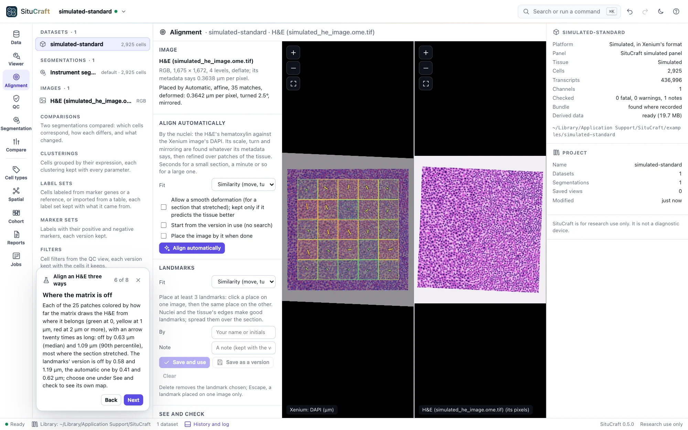
</picture>

**See and check** shows on the Xenium image (the left) any version of the alignment, the
landmarks' fit before it is saved, or nothing:

- **Over the stains** at an opacity; **a checkerboard** of the image and the stains, in squares of
  a size you choose (a structure that runs straight across the squares' edges is aligned there);
  or **flickering** between the image and the stains (what moves is off).
- **DAPI's edges** over the image, in yellow: the nuclei as the Xenium image sees them, on the
  image's nuclei. **The nuclei's outlines** draws the Xenium segmentation's instead.
- **Move the images together** keeps both images on the same place as you pan.

**Measure where it is off** checks a saved version over the whole section, as a job: patches of the
Xenium image's DAPI where there is tissue, each compared with the image drawn there as the version
places it (patches between those an automatic alignment used, so that it is not checked by its own
matches). It reports how far the version is off, in µm (the median, the 90th percentile and the
most, over how many patches), and a bound of the matches' own error: an error below it may be the
matches', one well above it is the alignment's. **Show where it is off** draws each patch as a
square colored by its error (green at 0, yellow at 1 µm, red at 2 µm or more) with an arrow from
where the image belongs to where it is drawn, twenty times as long. Check two versions to compare
them: 10x's alignment against an automatic one, or one with a deformation against one without.

## Regions: drawing on the tissue

The Viewer's **Regions** draws areas on the tissue, over any layer (the stains, an H&E or an
immunofluorescence image): a tumor's invasive front, a stromal band, an area to leave out. Choose a
**class** (QuPath's own: Tumor, Stroma, Immune cells, Necrosis, Other, Region\*, Ignore\*, or a new
one), then a tool:

- **Rectangle:** drag it.
- **Polygon:** click its corners; double-click, press Enter or click its first corner to close it;
  Backspace takes the last corner back.
- **Freehand:** drag around it.
- **Brush:** paint it, the brush's size in pixels of the screen (zoom in for a fine edge). With a
  region chosen, the brush paints onto it, or with **Erase** takes from it, holes included.

<picture>
  <source media="(prefers-color-scheme: dark)" srcset="images/regions-dark.webp">
  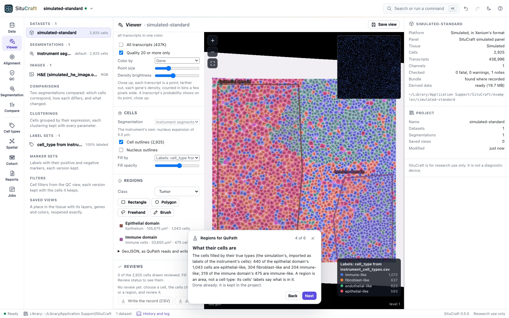
</picture>

While a tool is chosen the wheel still zooms, holding the space bar pans, and Esc stops drawing.
Each region is listed with its class, area and cells: those of the segmentation drawn whose center
lies in it. Click one to choose it; double-click to go to it. A region chosen can be renamed,
reclassed, gone to, removed, and its cells chosen: **Choose its cells** chooses the instrument's
cells in it, as brushing a plot in the QC view does, and the Viewer, the QC view and the inspector
show them.

Every change is a **version** of the region, with who made it, when and why: the region chosen
lists its versions, and any earlier one can be restored. A region removed is kept with its versions.
Regions are kept in the project.

**With QuPath.** Under **GeoJSON, as QuPath reads and writes it**, regions are written and read as
QuPath writes and reads annotations, in one of:

- **µm**, the dataset's own coordinates;
- **the Xenium image's pixels**, as QuPath opens `morphology_focus`;
- **a post-Xenium image's pixels**, as QuPath opens that image: through the version of its
  alignment in use.

To take regions to QuPath, choose the image you will open there (the H&E, say) and **Write them
all**; in QuPath, open that image and import the file's objects. To bring QuPath's annotations here,
export them from QuPath as GeoJSON, choose the image they were drawn on, and **Read a file…**: each
annotation becomes a region, with its name, class and color; detections and cells are left out,
and how many is reported.

## Reviewing cells and regions

A review is a decision about cells or a region, kept with its provenance: who made it, what, the
value before and after, when, of which segmentation and label set, each cell's label and its
confidence as you saw them, and which version of each post-Xenium image's alignment was in use (and
whether the image was shown). Reviews are never changed or removed: taking one back is another.

- **Accept** a label (or a region's class), or **Relabel** it, saying why. Relabeling cells adds to
  a curated set begun from the label set shown (the Viewer then shows it); relabeling a region
  reclasses it, as a version of it.
- **Ambiguous**: it could be one of several labels (name them if you can).
- **Exclude** it from analyses, saying why (a fold, debris, outside the tissue); **Include again**
  takes an exclusion back. Excluding a region can exclude the cells in it too.
- **Segmentation concern**: its segmentation looks wrong (cells merged, a cell split, its boundary
  off, not a cell, cells missed); **Resolve the concern** when it is answered.
- **Comment**: a note, changing nothing.

Review where you look:

- **A cell:** click it in the Viewer; its inspector shows its label in the label set filling the
  cells (fill by a label set to review labels) with its confidence, its reviews, and the review
  buttons.
- **Many cells:** choose them (brushing a plot in the QC view, or a region's **Choose its cells**);
  the Viewer's **Reviews** reviews them together.
- **A region:** choose it under **Regions**; **Review it** under its details.
- **The review queue** of the Cell types view (above).

<picture>
  <source media="(prefers-color-scheme: dark)" srcset="images/reviews-dark.webp">
  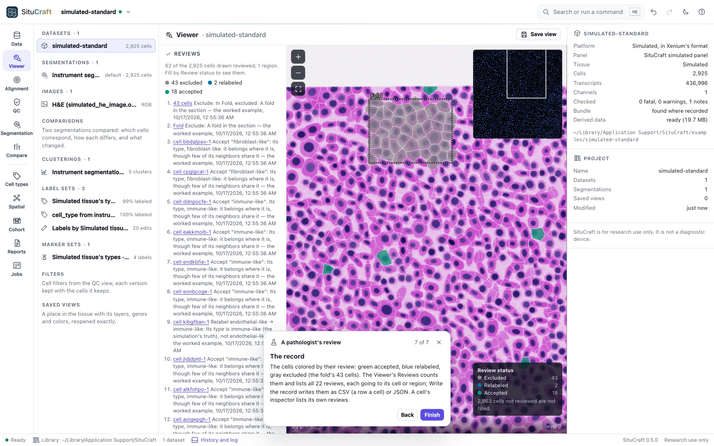
</picture>

The Viewer's **Reviews** counts the cells drawn that are accepted, relabeled, ambiguous, excluded,
of concern and commented, lists every review (click one to go to its cell or region), and writes the
record as CSV (a row for each cell or region reviewed) or JSON. **Fill by: Review status** colors
each cell by its review: excluded gray, a concern vermillion, ambiguous orange, relabeled blue,
accepted green, commented purple (a palette apart in every color vision).

## Spatial: which cells are neighbors

The **Spatial** view asks how the tissue is organized. Every such question starts from which cells
count as neighbors: a **graph** joins neighboring cells, by one of four definitions.

- **Delaunay triangulation:** each cell joined to the cells around it, by the triangulation of the
  cells' centers, however dense the tissue. Across a tear, a hole or the tissue's edge it would join
  cells far apart, so edges longer than the **longest edge** (50 µm by default) are left out.
- **Nearest neighbors:** each cell joined to its k nearest (6 by default), and so to any cell of
  which it is among the k nearest. Every cell has neighbors, but at the tissue's edge, or alone,
  they may be far.
- **Within a radius:** cells whose centers are at most the radius apart (20 µm by default). The same
  distance everywhere, so dense tissue gives cells many neighbors and sparse tissue few or none.
- **Contact:** cells whose outlines touch in the segmentation, with the boundary they share. A
  **gap** lets cells that nearly touch count as in contact; a cell between two others still keeps
  them apart.

Choose the segmentation (the default first) and the cells: all of them, a QC filter's (the
instrument's segmentation), or only those in regions you drew. Cells a review excluded from
analyses are always left out, and the view says how many. **Build the graph** builds it as a job;
it is kept as an artifact with its definition and the cells it was built over, and the same
definition over the same cells gives the same graph on any computer.

<picture>
  <source media="(prefers-color-scheme: dark)" srcset="images/spatial-dark.webp">
  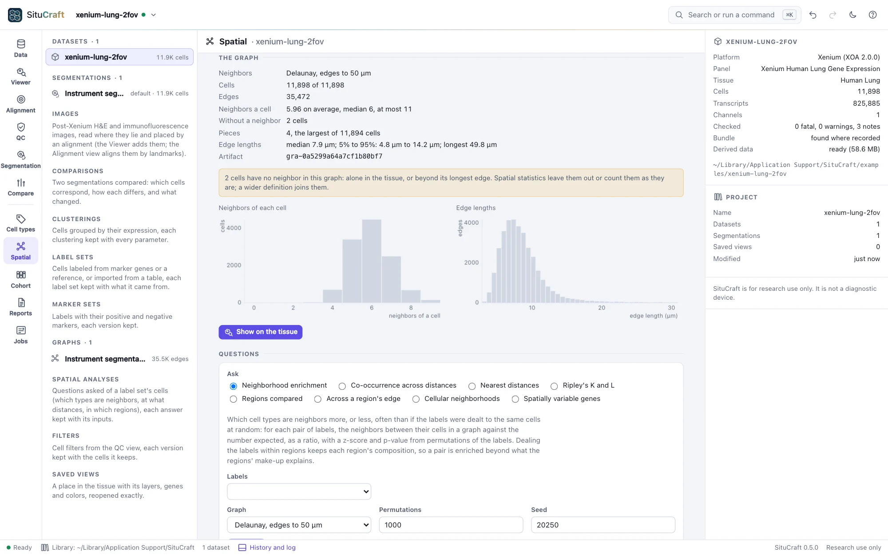
</picture>

Each graph says what it holds: its cells and edges, how many neighbors a cell has, the cells without
a neighbor (alone, or beyond the radius or the longest edge), how many pieces it falls into, and how
long its edges are, with histograms. Check these before using a graph: a radius that gives most
cells dozens of neighbors, or leaves many with none, is the wrong radius for this tissue.

**Show on the tissue** draws the graph's edges over the cells in the Viewer (the Cells section's
**Graph** chooses among the graphs of the segmentation drawn). Edges are drawn once you zoom in
far enough to read them. Click a cell: its edges turn yellow, and its inspector lists its
neighbors, nearest first, with their distances (and, with the cells filled by a label set, their
labels); click a neighbor to go to it. Saved views keep the graph.

<picture>
  <source media="(prefers-color-scheme: dark)" srcset="images/graph-dark.webp">
  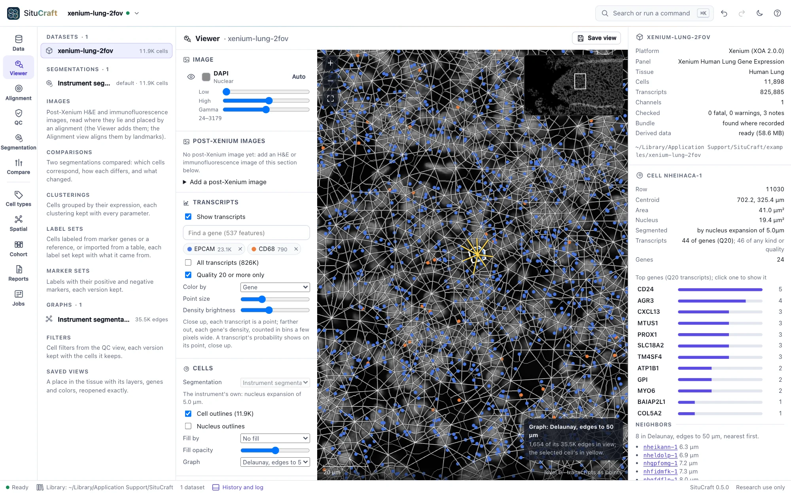
</picture>

### Which cell types are neighbors

Under **Questions**, ask a question of a label set's cells (the Cell types view labels them; any
label set of the segmentation and any of its levels can be asked).

**Neighborhood enrichment** counts, for each pair of labels, the neighbors between their cells in a
graph you built, and compares the count with the number expected if the labels were dealt to the
same cells at random. The expectation is computed exactly; the permutations (1,000 by default,
seeded) say how far from it chance alone strays.

- **The ratio** of found to expected is the size of the effect: 2× means twice the neighbors chance
  gives. The heat map colors each pair by it, red for more, blue for fewer, and marks the pairs
  whose adjusted p-value is below 0.05.
- **z and the p-value** say how unusual the count is in this section. The p-value is the share of
  permutations at least as far from the expectation (never below one over the permutations plus
  one: with many labels, use more permutations), adjusted over the pairs by Benjamini and Hochberg's
  procedure.
- **Deal the labels within regions** to ask whether two types are neighbors beyond what the regions'
  make-up explains: a tumor region full of tumor cells makes tumor cells each other's neighbors, and
  dealing within it keeps that.
- With a **contact** graph, neighbors can be counted by the **boundary** the cells share; the
  contact fractions then give each label's boundary by the label it touches.

<picture>
  <source media="(prefers-color-scheme: dark)" srcset="images/enrichment-dark.webp">
  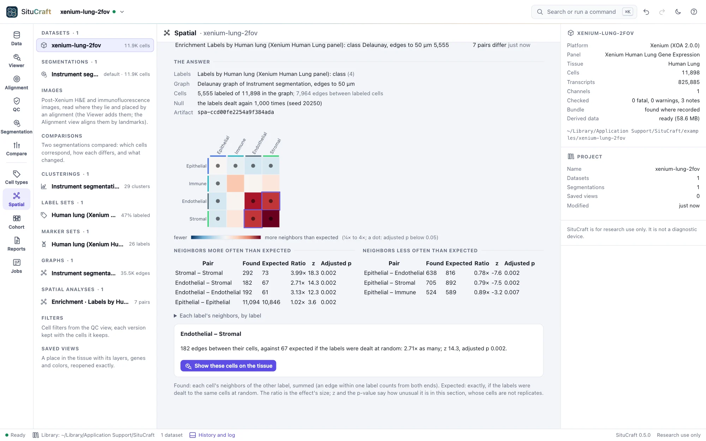
</picture>

Click a square, or a row of the tables, for the pair's numbers in words; **Show these cells on the
tissue** opens the Viewer with the cells filled by their labels, the pair's cells (those with a
neighbor of the other label) highlighted, and the edges between them drawn in color over the graph.

**Co-occurrence across distances** asks, from one label's cells, how much likelier each label's
cells are within a distance (10 to 150 µm by default) than any cell is: above 1, found that near
more often than their share. It counts the pairs within each distance as Squidpy does, or, to read
each distance on its own, the pairs since the distance before. It is descriptive, without a test.
Choose a label and a distance to show those cells on the tissue.

### How far apart, and at what scale

**Nearest distances** measures, for each label's cells, the distance to the nearest cell of each
label (another of their own, for a label with itself), searched up to a reach (100 µm). The median
is compared with the median when the labels are dealt again to the same cells: a shorter median
says the two lie nearer each other than their numbers explain, a longer one that they keep apart.
The heat map is red where nearer, blue where farther; it is not symmetric, since a rare label lies
near a common one more surely than the other way. Choose a pair for the distribution of its
distances (the share of cells whose nearest lies within each distance) against chance's envelope.

**Ripley's K and L** count how many cells of a label lie within each distance r of a cell of the
same or another label, in a **window**: the tissue (its cells' footprint, with gaps narrower than
twice the closing radius filled; holes such as airways and the space beyond the section left out)
or a region you drew. Cells near the window's edge have fewer neighbors inside it; Ripley's
isotropic correction counts each pair as if the circle through it lay wholly inside. L = √(K/π)
is a distance, equal to r for points scattered at random, so the curve shows L(r) − r. That line is
a reference only: cells cannot overlap and tissue is not uniform. The comparison is with the labels
dealt again to the same cells, as a band (the permutations' 2.5% to 97.5%), and a global test over
the radii. Above the band, a label's cells gather (or two labels draw together) at that scale;
below it, they spread out (or keep apart). Keep the radii below about a quarter of the window's
width.

<picture>
  <source media="(prefers-color-scheme: dark)" srcset="images/ripley-dark.webp">
  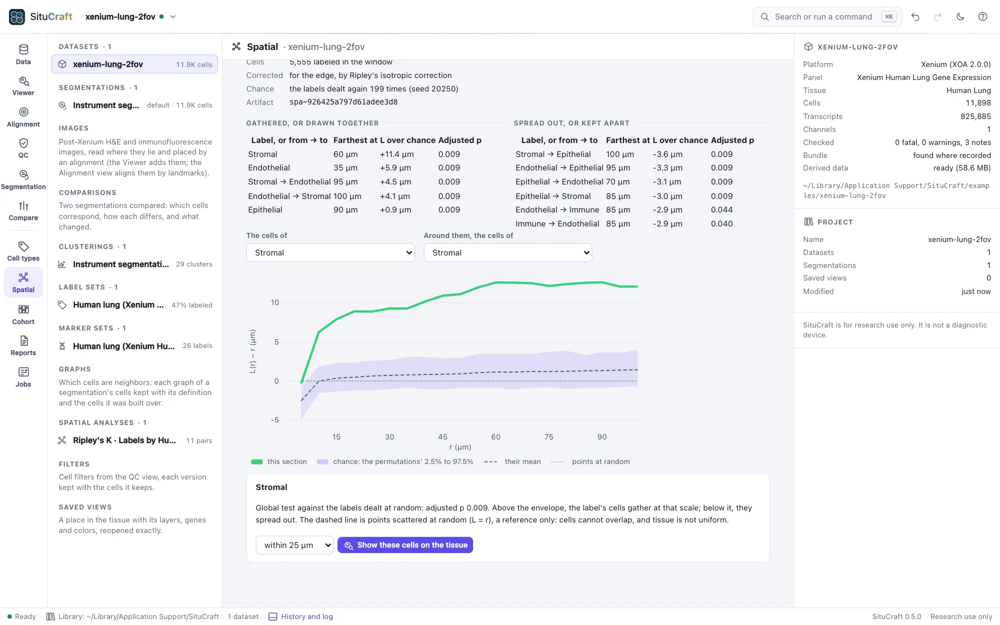
</picture>

Choose a distance, and **Show these cells on the tissue** highlights the cells within it of each
other.

### Regions measured

Two questions are asked of regions you drew (or read from QuPath).

**Regions compared** counts each region's cells by label, two ways: per mm² of the tissue within the
region (a density) and per labeled cell in it (a share). The tissue is the window Ripley's K uses,
so a region drawn loosely over the edge of the section, or around an airway, is not diluted by the
glass inside it. The tissue in none of the regions is a row of its own. Each number has a 95%
interval (Garwood's for a count, Wilson's for a share). Choose two rows to compare them, as each
label's ratio with its interval (a forest plot, filled where the interval is clear of 1).

<picture>
  <source media="(prefers-color-scheme: dark)" srcset="images/compared-dark.webp">
  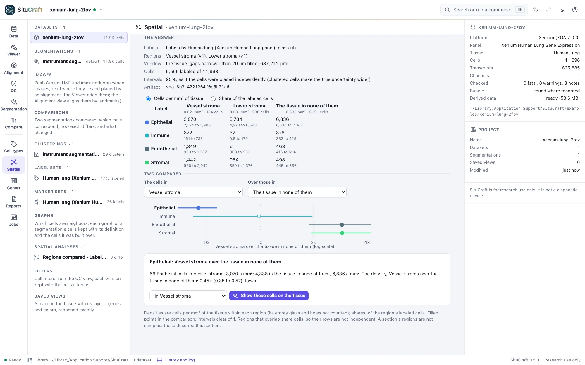
</picture>

**Across a region's edge** measures each label's density in bands of distance from a region's
edge, every 10 µm from 100 µm inside to 100 µm outside (the deeper and the farther a band each),
each band's own area of tissue its denominator. Three zones, as a tumor's core and invasive margin
are measured: the core (inside, beyond the margin), the margin (within 20 µm of the edge, either
side) and around (outside, beyond the margin, to the reach). A label **fills the region** when its
density in the core is above its density around (the interval of their ratio clear of 1), **stays
out** when below, and **gathers at the margin** when the margin is denser than both. The profile
shows a label's density band by band; a band with little tissue (deep inside a small region) is
drawn hollow.

<picture>
  <source media="(prefers-color-scheme: dark)" srcset="images/edge-dark.webp">
  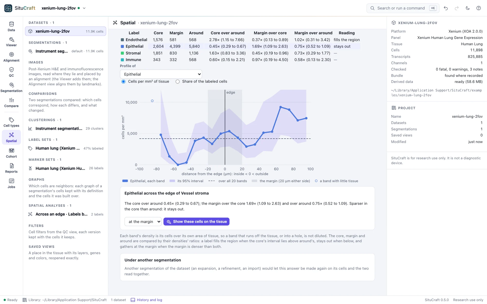
</picture>

**Show these cells on the tissue** highlights a label's cells in a region, or in the core, at the
margin or around.

The intervals treat cells as placed independently. Cells cluster, so the true uncertainty is
wider.

### Cellular neighborhoods

**Niches** are kinds of place in the tissue. Each cell's neighborhood (its 10 nearest labeled
cells, itself among them when it is labeled, or the labeled cells within a radius) is described by
its labels' shares, and the cells are grouped by these by k-means into niches. A niche is a kind of
place, not a kind of cell: an unlabeled cell has the niche of the labeled cells around it. Niches
are numbered by size and named by the labels they hold more of than the tissue does, with their
shares: "4 · Endothelial 25%" is a place where a quarter of the cells are endothelial, against 6%
in the tissue, though most are still epithelial.

<picture>
  <source media="(prefers-color-scheme: dark)" srcset="images/niches-dark.webp">
  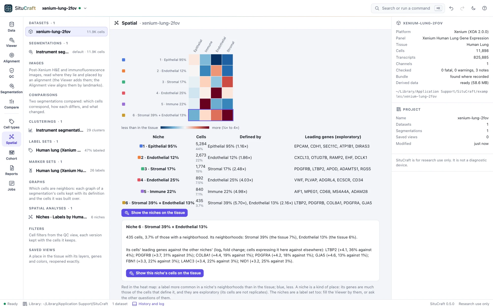
</picture>

The heat map shows each niche's make-up against the tissue's, red where a label is commoner in it.
Each niche's leading genes are those of its cells against the other niches' cells; they are much
the genes of the cells that define it, and exploratory. k-means finds a good answer from where it
starts, not always the best: the niches are found again from other seeds and compared with the
adjusted Rand index. Agreement near 1 says the niches are stable; low agreement says there are more
niches than the tissue holds kinds of place (try fewer, or larger neighborhoods).

**Show the niches on the tissue** fills every cell by its niche. Niches are a label set too: the
Viewer's fill lists them, and the other questions can be asked of them (which niches neighbor
which, or fill a region).

<picture>
  <source media="(prefers-color-scheme: dark)" srcset="images/niches-tissue-dark.webp">
  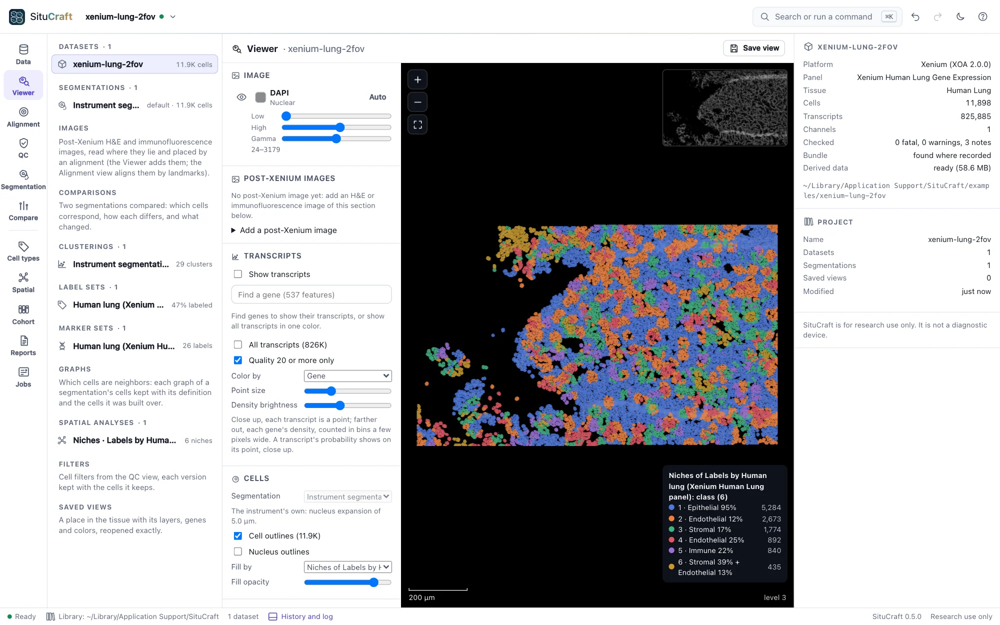
</picture>

### Spatially variable genes

**Spatially variable genes** asks which genes are expressed in a pattern across the tissue. It is
of genes, not labels: choose a graph and ask. Each gene's **Moran's I** measures how alike its
expression is in neighboring cells: near 1 when neighbors are alike, about 0 for no pattern, below
0 where neighbors differ. Each gene is tested against its values dealt to the cells at random,
analytically and by permutation, and the p-values are adjusted over the genes. Genes of cell types
that gather are in a pattern because their cells are.

<picture>
  <source media="(prefers-color-scheme: dark)" srcset="images/moran-dark.webp">
  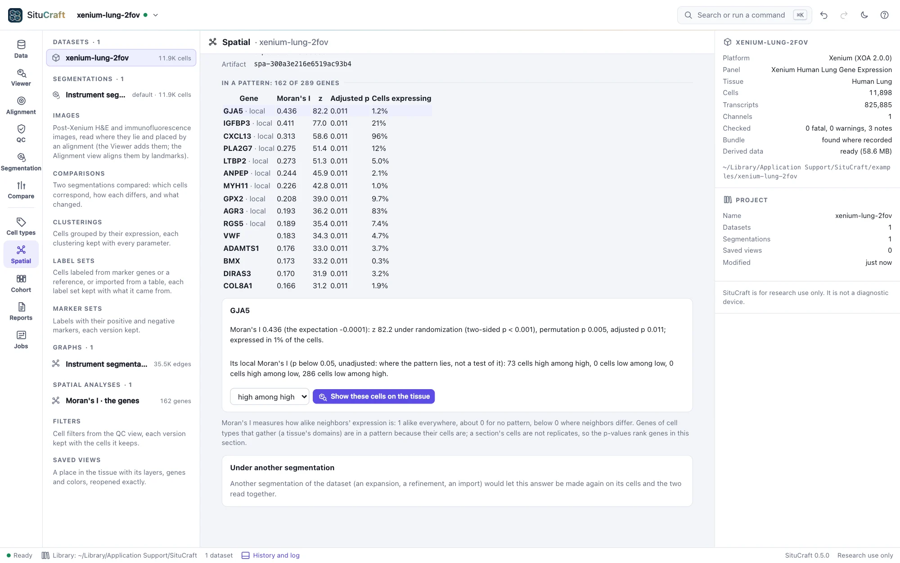
</picture>

For the leading genes (10 by default), **local Moran's I** shows where a pattern lies: each cell
high among high, low among low, or unlike its neighbors (by a permutation test of each cell, not
adjusted: it shows the pattern, it does not test it). Choose a gene and a class, and **Show these
cells on the tissue**.

<picture>
  <source media="(prefers-color-scheme: dark)" srcset="images/moran-tissue-dark.webp">
  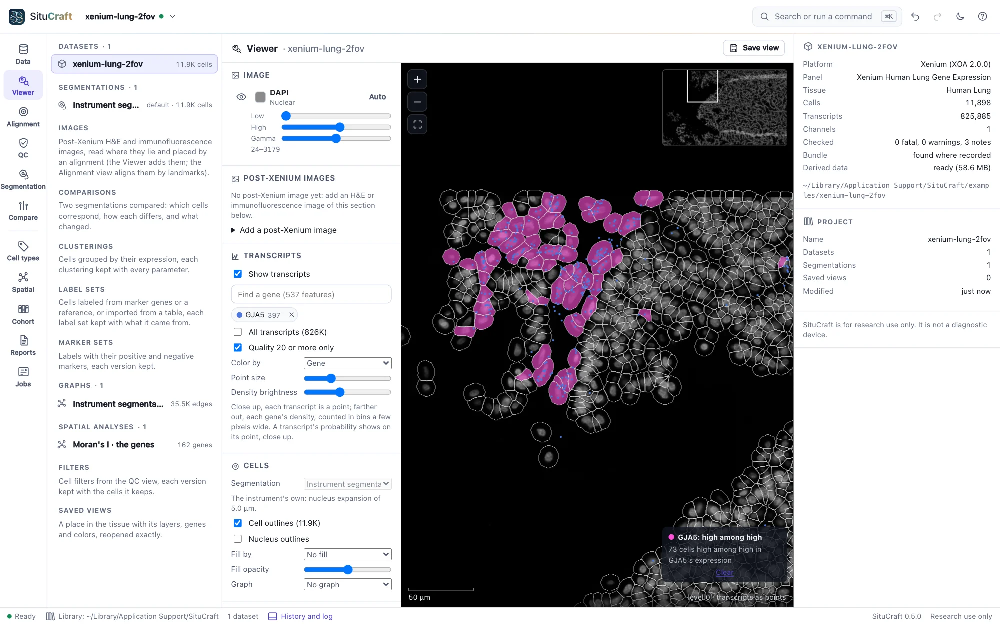
</picture>

### Under another segmentation

An answer depends on the cells it was asked of. To see how much, make it again on another
segmentation of the dataset (an expansion, a refinement, an import): under the answer, **Under
another segmentation**, choose one and **Make it again on**. SituCraft compares the two
segmentations (or uses their comparison), makes the labels again on the other's cells from the same
clustering and marker set, builds a graph of the same definition, and asks the same question with
the same parameters and regions. Labels curated by hand, agreed among sets, imported for one
segmentation's cells, or niches cannot be made again this way; it says what to do instead.

**Read together** lists every number under both, the largest changes first, and the rank
correlation of the two answers (near 1: the same order). Choose a change to find the cells behind
it: of its labels' cells, those whose counterparts under the other segmentation carry another label
or none.
Show them under either segmentation.

<picture>
  <source media="(prefers-color-scheme: dark)" srcset="images/remake-dark.webp">
  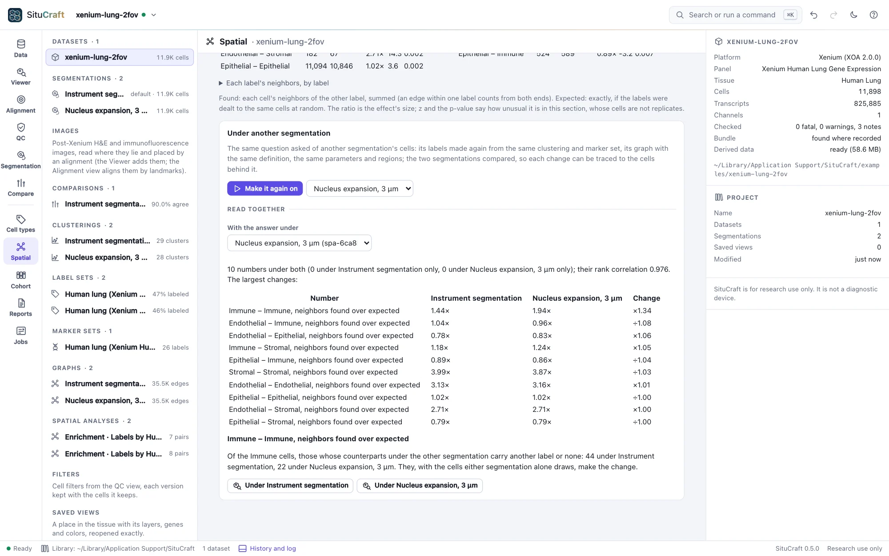
</picture>

A number that changes much between segmentations is a number of the segmentation as much as of the
tissue. On the simulated tissue, the enrichment of its types and its niches hardly change between
its true cells, the instrument's and a refinement; Moran's I of the marker genes nearly doubles under
the instrument's expansion, whose cells take transcripts from their neighbors.

A section's cells are not independent replicates: these numbers describe this section. Comparing
conditions needs samples, compared as samples (a later release).

## Keyboard

| Action | Keys |
| --- | --- |
| Search and commands | ⌘K |
| Open a bundle; a saved project | ⌘O; ⇧⌘O |
| Save now | ⌘S |
| Undo; redo | ⌘Z; ⇧⌘Z |
| Go to a view | ⌘1 … ⌘9 |
| Hide the project tree; the inspector | ⌘\\; ⇧⌘\\ |
| History and log | ⌘J |
| Viewer: pan; zoom; whole tissue; clear the cell | arrows; + and −; 0; Esc |
| Drawing a region: close a polygon; its last corner back; pan; stop | Enter; Backspace; hold space; Esc |
| All shortcuts | ? |

On Windows and Linux, use Ctrl for ⌘.

## Where things are kept

| What | Where (macOS; Linux; Windows) | Flag |
| --- | --- | --- |
| Projects | `~/Library/Application Support/SituCraft`; `~/.config/SituCraft`; `%AppData%\SituCraft` | `--data-dir` |
| Example datasets | the `examples` folder of the above | `--examples-dir` |
| Derived data (can be deleted) | `~/Library/Caches/situcraft`; `~/.cache/situcraft`; `%LocalAppData%\situcraft` | `--cache-dir`, `--cache-limit` |

SituCraft listens only on this computer (127.0.0.1) and sends nothing anywhere. Its only request
to the internet is an example's download, when you ask for it.

## If something goes wrong

- **The window does not open:** `situcraft --window browser` uses your default browser instead;
  `--window none` prints the address to open yourself.
- **"Start SituCraft with its program":** the page was opened without SituCraft running; run
  `situcraft`.
- **The Viewer needs WebGL2,** which current Chrome, Edge, Firefox and Safari have.
- **A bundle will not open:** the Data view lists each fatal finding with its remedy.

SituCraft is for research use only. It is not a medical device and makes no diagnostic claims.
